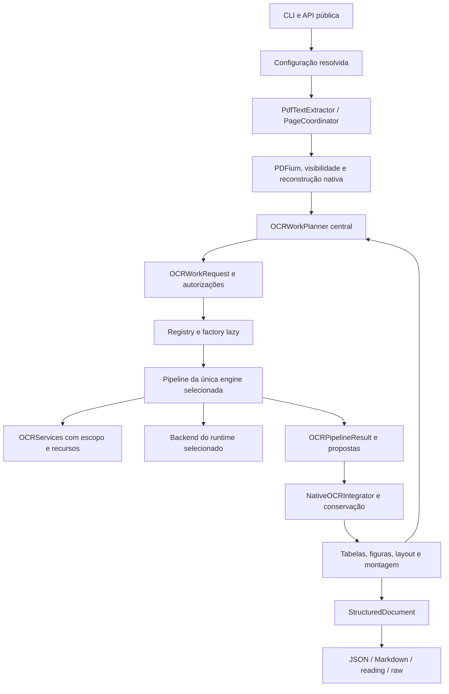

# Plano de desacoplamento das engines OCR

- **Projeto:** PDFExtractor / `structured-pdf-text`.
- **Data:** 20/10/2026.
- **Versão do plano:** 1.1, execução autorizada e em andamento.
- **Estado:** implementação integral solicitada; aceite final depende das evidências listadas na seção 17.
- **Base examinada:** branch `pipelines-improvement`, commit `54885e699190015c0bd4c026a3b24f2b296aed8c`.
- **Entrega pretendida:** quatro pipelines OCR independentes, com seleção e conservação centrais, migração incremental e compatibilidade verificável.

## 1. Finalidade, fontes e limites desta entrega

Este plano orienta a evolução da arquitetura OCR sem substituir o extrator nativo, a representação estruturada do documento ou o avaliador. O resultado deve permitir evoluir EasyOCR, PaddleOCR, RapidOCR e Tesseract individualmente, incluindo reconhecimento, recuperação, qualidade e preferências de integração, sem modificar estratégias das demais engines.

O plano foi originalmente elaborado como especificação. Em 21/10/2026, o usuário solicitou a implementação integral das etapas PR-00 a PR-14. Esta autorização cobre alterações locais, validação, preparação de modelos e atualização dos documentos de estado. A conclusão continua condicionada a evidências reais; plataformas indisponíveis, capturas incompletas e smokes pendentes permanecem explicitamente pendentes.

### 1.1. Fontes e precedência

1. Solicitação atual do usuário: implementar tudo o que está previsto neste documento, sem parar em marcos intermediários salvo dúvida real.
2. Código, testes, configuração, scripts e contratos do checkout acima: fonte dos fatos sobre o estado atual.
3. Documentos fornecidos, ambos de 15/10/2026 e baseados no snapshot `9872ab1f7462`:
   - `../MAPEAMENTO_REFATORACAO_PIPELINES_OCR_PDFEXTRACTOR.md`, relativo à raiz do repositório;
   - `../PLANO_DETALHADO_PULL_REQUESTS_DESACOPLAMENTO_PDFEXTRACTOR.md`, relativo à raiz do repositório.
4. README, planos, relatórios e auditorias do repositório: contexto e evidências históricas, sempre com suas limitações.
5. Fontes oficiais externas: confirmação do manifesto/API de modelos. A homologação depende dos smokes com artefatos reais descritos na seção 13.

Expressões como “decisões vinculantes”, “executar” e “abrir PR” nos anexos são conteúdo das propostas recebidas. Seus requisitos técnicos foram consolidados como arquitetura alvo e sua execução foi posteriormente autorizada pelo usuário. A atualização do estado e das evidências de implementação fica em `docs/OCR_Decoupling_Implementation_Status.md`. Quando há diferença entre o snapshot descrito e o checkout, este plano registra a diferença.

### 1.2. Abrangência da leitura

O levantamento percorreu a árvore versionada, as definições e dependências dos módulos Python, os pontos de chamada OCR, testes, ferramentas, configuração de distribuição/CI e documentação relacionada. O inventário inicial contém 378 arquivos versionados: 121 fontes Python em `src/` (41.621 linhas), 112 em `tests/` (36.882 linhas) e 24 em `scripts/` (8.788 linhas). Há 1.904 funções `test_*` nos arquivos de teste; isso é contagem estática, **não** quantidade de casos coletados ou aprovados pelo pytest.

Foram aprofundados os fluxos de extração, refinamento, geometria, recursos, workers, integração, serialização, readiness, provisionamento e avaliação. Corpus, geradores e manifestos foram considerados como contratos de validação. Não se pretende auditar linha a linha dependências de terceiros, pesos, binários, caches, resultados gerados ou todos os pixels dos PDFs. A configuração local do RapidOCR foi inspecionada como evidência de ambiente, sem importar seu runtime.

Já existiam dois arquivos não versionados, preservados nesta entrega: `docs/audits/REVISAO_EXTRACOES_LOOP001_2026-10-20.md` e `docs/audits/review_loop001_extractions.py`. O relatório foi considerado como diagnóstico local em andamento, sem transformar suas conclusões em nova homologação desta sessão.

Não foram executadas extrações OCR, benchmarks ou a suíte de runtime para redigir este plano. Resultados citados de auditorias anteriores pertencem às respectivas execuções; não são resultados novos.

### 1.3. Como utilizar o plano

As seções 2–11 definem diagnóstico, arquitetura e contratos. A seção 12 organiza o trabalho em PRs. As seções 13–17 estabelecem validação, rastreabilidade, riscos e conclusão. O apêndice A cobre o impacto em toda a árvore do projeto; o apêndice B registra a revisão do próprio plano.

Os nomes de componentes novos são propostas. Podem ser ajustados em revisão arquitetural, desde que os limites de responsabilidade e os critérios de aceite permaneçam. Referências a símbolos existentes são mais estáveis que números de linha.

## 2. Diagnóstico confirmado no checkout

### 2.1. Fluxo existente

O projeto já possui abstração de backend; o problema é o alcance dessa abstração. `OcrEngine` oferece reconhecimento de página/região e `OCRBackend` acrescenta um contrato de benchmark, identidade e capacidades. Entretanto, `api.py` continua escolhendo escalas, executando refinamentos, selecionando candidatos, interpretando atributos de engines e alterando tabelas. Ter quatro classes de backend não basta para isolar essas decisões.

Fluxo atual, resumido a partir de `PdfTextExtractor._extract_impl`:

```text
PDFium → evidência nativa → render de complexidade quando permitido
       → visibilidade/oclusão → reconstrução nativa → layout/qualidade regional
       → decisão central: página, regiões e figuras
       → backend selecionado + refinamentos coordenados em api.py
       → alinhamento/fusão → tabelas nativas/visuais → novos refinamentos de células
       → layout OCR → montagem de página/documento → renderers
```

As solicitações de células podem surgir depois do primeiro reconhecimento. Uma página pode, portanto, precisar de vários trabalhos OCR em estágios diferentes. O plano não deve congelar todos os trabalhos no início da página.

### 2.2. Pontos de acoplamento e seus efeitos

| Local atual | Fato observado | Consequência para a migração |
| --- | --- | --- |
| `api.py` — 3.484 linhas | Seleção, execução, refinamentos, conservação, tabelas e centenas de campos diagnósticos na mesma unidade | Extrair por responsabilidade, preservando a ordem do fluxo; redução de linhas isolada não comprova desacoplamento |
| `api.PdfTextExtractor._ensure_ocr_engine` | Factory tardia e injeção `ocr_engine=` já existem | Preservar lazy loading, assinatura pública e ciclo de vida |
| `api._extract_impl` | Passa imagem de página para recuperação regional e de figuras | O novo caminho deve entregar ao pipeline somente pixels autorizados |
| `api._recover_selected_regions`, `_recover_weak_ocr_regions` | Escalas, gatilhos, ranking e aceitação compartilhados | Migrar políticas para cada engine e manter mecanismos geométricos reutilizáveis |
| `api._refine_*` | Refinamento de notas, dados críticos, células, tabelas visuais e figuras | Separar identificação/autorização, reconhecimento e aplicação ao documento |
| `api._attach_ocr_provenance` | Infere CRAFT/DBNet18 pelo nome da engine/candidato | Proveniência especializada deve ser emitida pela engine, não deduzida no núcleo |
| Diagnósticos em `api.py` | Campos `easyocr_*`, consulta de `last_*`, `consume_page_diagnostics()` e tratamento específico de fallback | Normalizar resultado tipado e manter projeção de compatibilidade fora do coordenador |
| `config.py` — 549 linhas | Lista literal de engines, aliases, escalas e calibração por engine | Registro único e resolução de settings locais; evitar ciclos registry/config |
| `ocr/registry.py`, `ocr/factory.py` | Metadados estáticos e `match` fixo; CLI e scripts repetem listas | O registro precisa descrever construtores, settings e probes, além de nomes |
| `ocr/recovery.py` — 1.403 linhas | Mistura crop/rotação/tiles com orçamento por nome, scoring, filtros e merge numérico | Separar mecanismo e política sem clonar o refiner quatro vezes |
| `ocr/quality.py` — 619 linhas | Medições genéricas, `PaddleRawMetrics`, quality gates e fórmulas de score | Medição compartilhada; calibração e escolha do candidato pertencem à engine |
| `ocr/backends/easyocr.py` — 2.831 linhas | Estratégias maduras dentro do backend, leitores auxiliares, orientação, cache, threads e pré-processamento | Encapsular primeiro; não reescrever ou repetir variantes no wrapper |
| `ocr/paddle.py` — 2.006 linhas | `PaddleOcrEngine` tem seleção de candidatos, consenso, variantes e integração do runtime | Continua sendo código específico de Paddle, com migração gradual e imports compatíveis |
| `ocr/backends/paddle.py` e worker | Caminhos direto e subprocesso, protocolo versão 4, deadlines de init/inferência | Preservar ambos inicialmente; corrigir espera/cancelamento antes de retirar deadlines |
| `ocr/backends/rapidocr.py` | Rec Latin v5 configurado, detector pode vir do default do pacote, provider explícito | Capturar identidade por estágio; não chamar toda a composição atual de “v5” sem comprovar detector/Cls |
| `ocr/backends/tesseract.py` | Execução externa, PSM/OEM/OSD, TSV, timeout de 120 s e OSD de 30 s | Pipeline próprio e cancelamento real do subprocesso |
| `ocr/readiness.py` | `probe_static` ramifica por engine; ramo EasyOCR pode importar `easyocr.config` | “Estático” precisa garantir ausência de import pesado, não apenas ausência de inferência |
| `ocr/__init__.py` e CLI | Reexportam/importam módulos específicos de Paddle | Preservar imports públicos, tornando-os preguiçosos onde necessário; separar import de módulo e carga de framework |
| `native/pdfium_source.py` | Render de página, região e imagem embutida; PDFium serializado | Reutilizar a infraestrutura; não expor source/handles ao pipeline |
| `tables/cell_ocr.py` | Outro ponto público de OCR de células por callback | Migrar ou adaptar também esse consumidor; não deixar bypass regional |
| `evaluation/` e ferramentas | Avaliação canônica, publicação protegida e comparação já evoluíram após o snapshot | Consumir esses contratos; não criar um avaliador concorrente durante a refatoração |

### 2.3. Correções de premissas dos anexos

| Premissa anterior | Estado atual e tratamento neste plano |
| --- | --- |
| RapidOCR usa por padrão `latin_PP-OCRv3_rec_mobile.onnx` | Backend, readiness, setup, runners e verificador atuais apontam para `latin_PP-OCRv5_rec_mobile.onnx` e `ppocrv5_latin_dict.txt`. A migração começa nessa composição atual, não em uma baseline v3 presumida |
| Versão do pacote identifica a família completa | A instalação local declara RapidOCR 3.9.2, mas seu `config.yaml` contém Det/Rec v6 `small` como defaults. Isso não prova quais pesos uma execução carregou: o projeto sobrescreve Rec. A configuração efetiva pode combinar estágios de gerações diferentes |
| Todos os testes de worker exercitam a implementação real | O harness de `test_paddle_worker_protocol.py` reproduz `_raw_send`; parte das verificações pode passar sem testar a espera de produção. Novos testes devem usar os métodos reais com I/O substituído |
| Recursos fatais sempre propagam imediatamente | `errors.py` define exceções fatais, mas `OcrRegionRefiner` tenta recuperação por tiles após alguns OOMs e pode devolver `resource_exhausted`. Caracterizar e preservar a semântica inicialmente; não ocultar o incidente nem universalizar fatalidade sem teste |
| Não há redução automática de escala | O README faz essa afirmação, mas `_safe_complexity_scale` e o renderizador limitam dimensões. É necessário registrar escala solicitada/efetiva e reconciliar documentação e comportamento em mudança explícita |
| Captura posterior comprova modelo utilizado | `capture_ocr_run_identity.py` reconstrói um backend depois da execução e marca essa circunstância. É evidência auxiliar do ambiente posterior, não prova equivalente à identidade capturada durante a execução |
| Suíte e benchmark históricos suficientes para homologação atual | Relatórios de 19/10 registram schema `evaluation-3.0.0`, definições 3.0.5 e avaliações globais parciais. É necessário manter cobertura e inelegibilidade explícitas |

### 2.4. Defeitos conhecidos não são baseline de qualidade aprovada

A auditoria versionada de 19/10 descreve extrações V3/V4/V5 por um perfil RapidOCR/OpenVINO e avaliações globais `partial`, `rank_eligible=false`. A revisão local de 20/10 registra, entre outros casos, conteúdo coberto publicado em tabelas V3, omissões nativas de listas V5, problemas de orientação, tabelas raster sem estrutura e falsos estados de degradação em figuras sem texto.

Usar essas informações como **casos de caracterização e investigação**, sem atribuir todas as falhas ao OCR. Separar três trilhas:

- **Equivalência estrutural:** a refatoração não cria divergências adicionais em relação ao comportamento capturado.
- **Correções de integridade:** defeitos reproduzidos recebem PR próprio, nova expectativa e comparação com a baseline preservada.
- **Mudança de modelo:** RapidOCR v6 possui antes/depois próprios; não se exige igualdade textual com seu reconhecedor v5.

Um defeito conhecido pode permanecer registrado durante PRs internos de movimentação de código. Isso não autoriza declarar a qualidade final aprovada. Vazamento de conteúdo coberto é bloqueador de liberação para produção, mesmo que a equivalência com a baseline seja perfeita. Suas correções pertencem ao núcleo de visibilidade/tabelas e exigem regressão transversal.

## 3. Requisitos consolidados e invariantes

| ID | Requisito da arquitetura alvo | Prova mínima |
| --- | --- | --- |
| R01 | Uma engine por execução de extração; sem ensemble ou fallback para outra engine | Contagem de factories, imports e identidade dos resultados |
| R02 | Núcleo decide necessidade e extensão do OCR | Plano/autorização derivados de evidências, com razão por trabalho |
| R03 | `native` e `fast` não executam OCR nem render; `balanced` permanece seletivo | Zero construção de runtime e zero chamadas proibidas nos modos/casos correspondentes |
| R04 | `exhaustive` altera profundidade local, não a seleção inicial | Mesmo plano inicial sob a mesma evidência; variantes apenas dentro das autorizações |
| R05 | Políticas de reconhecimento, refinamento e integração específicas por engine | Testes de settings, dependências e alterações locais |
| R06 | Pixels, contexto e resultados ficam contidos no trabalho autorizado | Negativos de render, união de regiões, tokens, polígonos e sugestões externas |
| R07 | Conservação, visibilidade, geometria, ownership e documento final compartilhados | Integrador comum rejeita propostas inválidas e preserva conteúdo confiável |
| R08 | EasyOCR e PaddleOCRv6 preservados durante migração estrutural | Comparação por página/região com mesma configuração, ambiente e pesos |
| R09 | Nenhum deadline de carregamento, inferência ou refinamento imposto pelo projeto | Testes dos caminhos reais de espera, subprocessos e cancelamento |
| R10 | Tentativas, variantes, memória e raster continuam controlados | Planos finitos, reservas de recursos e diagnóstico de parada |
| R11 | Paddle oferece somente PP-OCRv6 em produção ao final | Rejeição explícita de `pt-v5`, manutenção de medium/small e históricos |
| R12 | RapidOCR usa Det/Rec PP-OCRv6 medium por padrão; small explícito | Identidade efetiva por estágio, hashes e matriz de providers |
| R13 | ONNX Runtime/OpenVINO são providers de RapidOCR | Um provider efetivo por execução, sem troca silenciosa |
| R14 | Compatibilidade pública preservada ou migrada explicitamente | CLI/API/imports/diagnósticos/benchmarks com testes de consumidores |
| R15 | Quinta engine entra por contrato e registro | Fixture executa sem editar coordenador nem pipelines existentes |
| R16 | Falhas e resultados parciais permanecem visíveis | Estados tipados, agregação sem falsos sucessos e exceções fatais preservadas |
| R17 | Comparações reproduzíveis e sem sobrescrita de artefatos | Manifestos de execução, hashes, schema, namespace e política de comparabilidade |

O default global de `ocr_engine` permanece **EasyOCR**. O default de modo de `ExtractorConfig()` e da CLI permanece **native**. “RapidOCR medium padrão” vale quando RapidOCR é a engine escolhida; não muda esses defaults.

As engines podem utilizar variantes internas, múltiplos detectores da própria engine ou APIs alternativas do mesmo runtime. Esses caminhos precisam ter identidade e diagnóstico; não autorizam chamar outra família OCR.

## 4. Arquitetura alvo e responsabilidades

### 4.1. Fluxo proposto



A aresta de tabelas/figuras de volta ao planejador representa novos trabalhos **finitos e autorizados**. Não representa repetição até atingir uma nota arbitrária. A inferência recebe apenas as imagens entregues pelo serviço; o pipeline não recebe o documento aberto.

### 4.2. Distribuição das responsabilidades

| Componente | Responsabilidade | Dependências permitidas |
| --- | --- | --- |
| `PdfTextExtractor` | Fachada pública, contexto/ciclo de vida e coordenação documental | Config, source, coordenador, registry/factory e montagem |
| `PageCoordinator` | Sequência dos estágios, evidências e resultados de página | Planejador, serviços, protocolo de pipeline e integrador |
| `OCRWorkPlanner` | Necessidade, página, envelope, objetivo, contexto filtrado e trabalhos adicionais | Evidências/decisão, layout, geometria e contratos; sem bibliotecas OCR |
| `OCRServices` | Acesso autorizado a raster/imagem embutida, transforms, recursos, eventos e cancelamento | Source mantido privado, geometria e limites centrais |
| `OCRPipeline` específico | Estratégia, variantes, seleção, recuperação e policy da engine | Contratos, mecanismos comuns, seu backend e seus settings |
| Backend específico | Carregar/fechar runtime, adaptar bibliotecas, parsers, processos e retorno bruto | Sua biblioteca/execução e tipos de fronteira |
| `OCRIntegrationPolicy` específica | Propor aceitação, complemento, substituição e prioridades segundo a engine | Snapshots de evidência e métricas, sem mutação do documento |
| `NativeOCRIntegrator` | Validar/aplicar propostas atomicamente, autorização, conservação e ownership | Tipos de domínio, mecanismos de fusão e regras centrais |
| Tabelas/figuras/layout | Detectar estrutura, gerar objetivos, manter associação e ordem | Evidências e resultados normalizados, sem importar engines |
| `assemble/`, renderers | Montagem, conservação final e representação de saída | Documento e mecanismos de domínio, sem runtime OCR |
| Avaliador | Medir resultado publicado segundo referências e contratos próprios | Artefatos/representação de avaliação; sem orquestrar produção OCR |

### 4.3. Dependências e composição

- `ocr/pipeline/` contém protocolos e serviços neutros. Não importa `ocr/pipelines/<engine>/`.
- `ocr/common/` reúne apenas mecanismos comprovadamente compartilháveis. Não importa pipelines, backends ou frameworks OCR.
- Um pipeline nunca importa outro pipeline ou o backend de outra engine.
- Registro/composição podem conhecer nomes das engines. Decisão, integrador e montagem não podem selecionar heurísticas por `if engine_name == ...`, tipo de classe ou substring de identidade.
- Metadados de configuração e probes estáticos não importam os frameworks. Constructors e probes profundos são carregados por import tardio.
- Código neutro pode receber callbacks ou objetos de policy; não deve receber o nome da engine para escolher um conjunto oculto de defaults.
- `ocr/paddle.py`, parser Paddle e política oneDNN permanecem específicos, ainda que seus caminhos históricos não contenham `pipelines/`.

Não criar uma superclasse que execute um algoritmo único para todos os OCRs e ofereça dezenas de hooks opcionais. Um `Protocol` pequeno, composição e utilitários puros são suficientes. Não criar módulos vazios apenas para reproduzir uma árvore simétrica.

### 4.4. Estrutura proposta, extraída conforme houver uso

```text
src/structured_pdf_text/
  api.py                             # fachada compatível
  orchestration/
    page_coordinator.py
    ocr_work_planner.py
  ocr/
    engine.py                        # contrato legado
    contracts.py                     # contrato raw/benchmark preservado
    registry.py                      # descritores e resolução de aliases
    factory.py                       # factories de backend e pipeline
    pipeline/
      contracts.py
      authorization.py
      services.py
      budgets.py
      diagnostics.py
      adapters.py                    # compatibilidade temporária
    common/
      recovery_mechanics.py          # mecanismos extraídos, sem calibração
      quality_metrics.py
    pipelines/
      easyocr/                       # pipeline, settings e policies locais
      paddle/
      rapidocr/                      # inclui resolução de perfil/modelos
      tesseract/
    backends/                        # adaptadores atuais preservados
    coordinates.py                   # geometria existente reutilizada
    image_views.py
    reconstruct.py
    paddle.py                        # caminho público preservado inicialmente
  fusion/
    integrator.py                    # aplicação de propostas
    conservation.py                  # invariantes de refinamento extraídas
  native/ layout/ tables/ assemble/ renderers/ evaluation/
```

Não mover `coordinates.py`, `image_views.py`, `reconstruct.py` ou contratos públicos só para acomodar a árvore. Se forem movidos posteriormente, manter reexports e testes de import. A fronteira de dependência importa mais que a localização estética.

## 5. Contratos de entrada, saída e integração

### 5.1. Três níveis de contrato, com conversão explícita

| Nível | Contrato | Uso e compatibilidade |
| --- | --- | --- |
| Documento atual | `document.OcrToken`, `TextToken`, `OcrProvenance`, `StructuredDocument` | Mantidos como tipos do domínio/saída |
| Backend atual | `OcrEngine` e `ocr.contracts.OCRBackend`, `OCRRequest`, `OCRToken`, `OCRResult` | Mantidos para injeção antiga, raw OCR e ferramentas |
| Pipeline novo | `OCRWorkRequest`, `OCRPipelineResult`, `OCRServices`, `OCRIntegrationPolicy` | Orquestra reconhecimento e refinamentos autorizados |

`document.OcrToken` e `ocr.contracts.OCRToken` são tipos diferentes; seus boxes e confiança não têm a mesma semântica. Não substituir um pelo outro por coincidência de nomes. Criar conversores testados nas fronteiras, com unidade, espaço de coordenadas, origem, escala de confiança e transform explícitos.

### 5.2. `OCRWorkRequest`

Contrato conceitual imutável, sem dependência de PIL, NumPy ou PDFium:

| Campo/grupo | Semântica proposta |
| --- | --- |
| `contract_version` | Versão do protocolo de pipeline, distinta da versão de avaliação |
| `request_id`, `parent_request_id`, `extraction_id` | Correlação estável de trabalho e contexto; request de outra extração não é válido |
| `document_id`, `page_index` | Identificação do documento e índice interno 0-based |
| `selection_stage` | Origem: página, região, figura, imagem embutida, célula/tabela, nota ou dados críticos |
| `authorizations` | Tupla de autorizações emitidas e registradas pelo núcleo |
| `goal` e `target_ref` | Tipo do trabalho e alvo, inclusive tabela/célula/figura quando houver |
| `page_geometry` | Bbox canônico, origem e rotação da página |
| `native_context` | Snapshot filtrado e imutável da evidência relevante; não contém documento/objetos mutáveis |
| `decision_reasons` | Motivos da autorização, distintos dos motivos de escolha de candidato |
| `quality_policy` | Intensidade comum `baseline`, `adaptive` ou `exhaustive` |
| `resource_allocation` | Limites/reservas de trabalho e memória aplicáveis, nunca segundos |

`frozen=True` sozinho não garante imutabilidade profunda. Converter coleções para tuplas/estruturas imutáveis e copiar mappings e snapshots recebidos. Não compartilhar `LayoutRegion`, `TableCell` ou suas listas mutáveis com o plugin.

Autorizações devem estar ligadas a página, extração, alvo, envelope e versão da evidência. O serviço consulta o registro central: uma string `authorization_id` criada pelo pipeline não concede acesso. Propostas baseadas em versão antiga de célula/região são rejeitadas ou reavaliadas, nunca aplicadas cegamente.

### 5.3. `OCRPipeline` e serviços

Assinatura conceitual:

```python
class OCRPipeline(Protocol):
    # identity/capabilities não carregam outra engine nem executam probe oculto.
    def execute(self, request: OCRWorkRequest,
                services: OCRServices) -> OCRPipelineResult: ...
    def close(self) -> None: ...
```

O descritor estático é consultável sem carregar modelos. A identidade efetiva é publicada após a inicialização e atualizada com os submodelos efetivamente utilizados. Capacidades declaradas e disponíveis devem ser distinguíveis; perguntar por capacidade não executa DBNet18 ou qualquer inferência oculta.

`OCRServices` fornece renderização por autorização, acesso controlado a imagem embutida, transforms, reserva/liberação de raster, consumo de tentativas, cancelamento e emissão de eventos. O acesso a raster devolve um objeto com imagem autorizada, geometria real e ciclo de liberação; não expõe o source nem referências que permitam recuperar pixels externos. Uma autorização de página inteira pode receber o raster integral; uma autorização regional recebe somente seus pixels.

O pipeline pode fazer pré-processamento e reconhecer várias vezes a mesma região autorizada. Alocações de resize/rotação/tiles controladas pelo projeto devem passar pelo mecanismo de orçamento. Tensores internos de bibliotecas continuam sujeitos a limites operacionais e tratamento de OOM; orçamento RGB não é garantia de teto de RSS do processo.

### 5.4. `OCRPipelineResult`

Deve conter:

- `contract_version`, request/autorizações e identidade efetiva da engine/provider;
- status do trabalho, tokens/evidências válidas em pontos canônicos, polígonos quando disponíveis;
- candidatos selecionados e alternativas relevantes, com tentativa de origem e razão;
- confiança nativa e sua escala; confiança normalizada somente se a conversão estiver declarada;
- propostas de integração, falhas locais estruturadas e sugestões de trabalho adicional;
- contadores, recursos observados, duração por estágio e diagnósticos com namespace da engine.

Não contém `StructuredDocument` nem referências mutáveis a tabelas/regiões da página. Não pode substituir, apagar ou inserir conteúdo diretamente. Não descartar tokens válidos só porque uma tentativa opcional falhou; o status deve informar a recuperação/degradação correspondente.

### 5.5. Propostas e aplicação atômica

Tipos de proposta: complementar região, substituir conjunto identificado de tokens, corrigir célula, associar tokens à figura e recomendar prioridade OCR para um alvo já autorizado. Cada proposta traz alvo, versão esperada, IDs de evidência substituídos, evidência nova e justificativa.

Ordem de validação pelo integrador:

1. Conferir versão de contrato, request, extração, engine/provider e autorização.
2. Conferir finitude, geometria, transform, proveniência e alvo atual.
3. Verificar visibilidade e ownership; conteúdo oculto/coberto não pode voltar por refinamento ou conservação.
4. Executar mecanismos de alinhamento/deduplicação e avaliar a proposta da policy individual.
5. Aplicar invariantes de conservação e dados críticos; registrar aceite ou rejeição.
6. Materializar mudança de região/célula de forma atômica, preservando linhagem; em falha, manter estado anterior.
7. Registrar idempotência por request/proposta: reaplicar o mesmo resultado não duplica conteúdo.

O integrador pode rejeitar uma proposta aprovada pela engine. A policy individual não reduz a proteção comum de dados críticos, visibilidade ou escopo. Ao mesmo tempo, conservação não deve tornar uma camada nativa defeituosa imutável: correção exige identificação da evidência não confiável e justificativa verificável.

Separar **invariantes obrigatórios** de **heurísticas atuais**. Sinais, valores confiáveis, conteúdo oculto e identidade são invariantes. Pesos de ranking, limiares de confidence, ganho mínimo de qualidade e escalas são policy local. Limiares atuais de similaridade/cobertura de conservação devem ser preservados durante sua extração; sua eventual recalibração requer mudança transversal explícita.

## 6. Autorização de regiões, geometria e recursos

### 6.1. Semântica geométrica

- Espaço canônico: pontos PDF, origem superior esquerda, x para a direita, y para baixo, coerente com `geometry.BBox` e a evidência atual.
- Índices de página internos são 0-based; CLI, relatórios e manifestos destinados a pessoas podem ser 1-based. Conversão ocorre em fronteira identificada.
- Uma autorização cobre um retângulo ou uma união exata de regiões. O retângulo envolvente de duas áreas separadas **não** autoriza o vão entre elas.
- Verificar valores numéricos finitos, dimensões positivas, limites da página e identidade. O `BBox` atual rejeita inversão, mas sozinho não rejeita todos os casos NaN/Inf; validar na nova fronteira sem alterar globalmente o tipo por acidente.
- Transformações encadeiam render, origem/CropBox, crop, rotação física da página, rotação de candidato e deskew. Deve haver exatamente um ponto responsável por cada transformação, com inversa testada.
- Escala efetiva deriva das dimensões realmente renderizadas, inclusive arredondamentos e redução por limites. Não mapear boxes usando apenas a escala solicitada.

Testar rotacionamento 0/90/180/270, CropBox deslocado, página não quadrada, escalas fracionárias, bordas, polígonos e roundtrip raster↔PDF. Reutilizar `ocr/coordinates.py`, `ocr/image_views.py`, `geometry.py` e a serialização PDFium existente.

### 6.2. Regras do serviço autorizado

1. Negar pedido fora da autorização **antes** de acessar/renderizar pixels. Interseção parcial não basta.
2. Pedidos internos usam contenção integral. Se o núcleo precisar cortar uma região na borda da página, emite a autorização já normalizada e registra o corte.
3. Padding, deskew e rotação expandida usam canvas sintético a partir dos pixels autorizados. Não acrescentar contexto real externo.
4. O núcleo pode usar render de página para complexidade/layout e reaproveitar seu cache. O pipeline regional recebe apenas uma cópia/view segura do crop autorizado, sem acesso ao raster completo.
5. Renderizar regiões separadamente ou mascarar áreas não autorizadas antes da entrega. A máscara não pode revelar o conteúdo do vão entre regiões.
6. Para imagem embutida, o serviço valida objeto, placement, geometria e autorização antes de extrair/entregar. Uma imagem original não pode revelar texto coberto que o render visível omite; quando essa equivalência visual não for demonstrável, usar raster da composição visível ou rejeitar a variante original.
7. Validar também tokens e polígonos retornados. Tolerância numérica serve para arredondamento e não concede área de leitura nova. Não aceitar linha que atravessa vão proibido só porque seu centro está autorizado.
8. Não “corrigir” bbox externo cortando texto por suposição. Rejeitar a hipótese inválida ou aplicar ajuste geométrico estritamente numérico documentado, mantendo a transcrição observada.

O objetivo é uma fronteira verificável para implementações cooperativas e para retornos defeituosos. Isso não cria sandbox de segurança para executar código Python hostil de terceiros.

### 6.3. Autorizações incrementais e parada

O núcleo autoriza página inteira em `ocr` e nas promoções já existentes. Em `balanced`, decide regiões/figuras sem depender da confiança de um runtime ainda não executado. Refinamentos internos podem usar sub-regiões do envelope autorizado.

Se um pipeline descobrir necessidade fora do envelope, devolve `additional_work_suggested` com alvo, bbox, evidência e razão. Somente o planejador pode emitir novo trabalho. Mesmo nesse caso, `exhaustive` não concede promoção automática para a página inteira.

Autorizações posteriores de tabela/célula/figura usam a estrutura atual. Trabalho adicional deve ter pai/estágio, fingerprint de alvo e conjunto finito de ações. Deduplicar sugestões equivalentes, impedir ciclos A→B→A e impor teto de trabalhos/tentativas por página. Saturação e ausência de ganho encerram o conjunto finito; não dependem de duração.

Comparar políticas de qualidade exige distinguir **plano inicial**, que deve permanecer igual com a mesma evidência, de trabalhos adicionais posteriores, que podem variar com os resultados. Exigir igualdade de todos os trabalhos finais entre policies esconderia a recuperação incremental pretendida.

### 6.4. Hierarquia de recursos

| Camada | Controla | Regra |
| --- | --- | --- |
| `SecurityLimits` central | Páginas, arquivo, pixels e bytes máximos | Nenhum override local pode aumentar o teto absoluto |
| Política da engine | RGB por tentativa, escalas, tiles, batches, concorrência e variantes | Defaults preservados e versionados durante a migração |
| Alocação por request/página | Rasters vivos, número de tentativas/trabalhos e recursos reservados | Reserva antes da alocação e liberação determinística |
| Runtime | Memória interna, processos e dispositivos | OOM/crash monitorados e classificados, sem prometer RSS máximo exato |

Distinguir **pico de bytes simultaneamente reservados** de **trabalho acumulado**. Liberar um raster devolve memória disponível; não devolve a tentativa já consumida. Contabilizar tiles e tentativas internas, evitando que chamadas aninhadas contornem o limite.

Preservar inicialmente os limites operacionais efetivos: 8 MiB no caminho legado compartilhado e 32 MiB para recuperação EasyOCR, com os overrides correspondentes. Isso não define os limites finais ideais de RapidOCR/Tesseract; cada engine passará a possuir sua própria configuração, inicialmente equivalente.

Preflight geométrico deve considerar RGB/cópias e o canvas **após** rotação/deskew, não apenas o crop original. Tiles mantêm resolução e escopo; podem ser uma alternativa explícita quando o raster único não cabe. Não inventar redução de resolução ou troca de modelo para fazer um caso passar.

Bloqueio preventivo de variante opcional é `budget_blocked`; OOM real é incidente distinto. Recuperação por tiles já existente deve manter registro do incidente. Esgotamento não recuperado de trabalho obrigatório segue a política de fatalidade/estado caracterizada e não pode virar `ok` silenciosamente. Mudanças nessa semântica são tratadas separadamente no PR-06.

## 7. Configuração, registry, factory e compatibilidade

### 7.1. Fonte única de composição

Evoluir `BackendEntry` para um descritor de pipeline com nome/aliases, metadados, factory lazy do pipeline/backend, resolver de settings, providers/perfis admitidos, capacidades declaradas, probes e indicação de setup. O descritor deve poder ser inspecionado sem importar bibliotecas OCR.

`PUBLIC_ENGINES`, CLI e validação de config derivam do registro, preservando ordem pública estável. Não deixar um `match` extensível na factory bloqueado por uma lista literal em `ExtractorConfig.__post_init__`. Probes e ferramentas de extração também precisam deixar de repetir a lista como validação universal.

Manter dois pontos de entrada:

- `build_ocr_backend(config)`: contrato de baixo nível para raw OCR, testes e consumidores existentes;
- `build_ocr_pipeline(resolved_config)`: execução de produção com estratégia da engine selecionada.

Ambos usam o mesmo resolver de modelos/settings para evitar medir uma instalação diferente da usada pelo extrator. Construir uma instância de pipeline por extrator e o runtime apenas no primeiro trabalho. Exibir ajuda, validar config ou extrair página nativa não constrói modelos.

Registro explícito no projeto e registry de teste bastam para esta migração. Descoberta de plugins externos por entry points não é requisito; se vier depois, deve preservar isolamento e validação de contrato.

### 7.2. Configuração resolvida

Preservar `ExtractorConfig` como fachada, inclusive `dataclasses.replace`, presets e campos antigos. Introduzir uma resolução imutável com configuração central e **um único objeto de settings da engine selecionada**. Nome sugerido do campo aditivo: `ocr_settings`; seu tipo é definido pelo descritor e deve concordar com `ocr_engine`.

O núcleo mantém modo, seleção de páginas, decisão nativa, layout/tabelas, conservação e tetos de segurança. Settings locais mantêm calibração, escalas, variantes, leitores, PSM/OEM, batch, modelo/provider e orçamento operacional. `ocr_quality_policy` continua sendo a intenção comum de intensidade.

| Superfície atual | Tratamento durante a transição |
| --- | --- |
| `ocr_engine="easyocr"` | Preservar default e aliases normalizados |
| `ocr_provider` | Apenas RapidOCR; ONNX Runtime default efetivo |
| `ocr_runtime` | Alias depreciado já existente; manter validação de conflito e aviso |
| `paddle_model_profile="pt"` | Pertence a Paddle; `pt`/`pt-v6-medium` equivalentes; v5 retirado no PR-12 |
| `ocr_quality_thresholds` | Compatibilidade; resolução específica migra para a engine sem mudar valores efetivos |
| `ocr_render_scale` / `best_ocr_render_scale` | Override público e wrapper compatível para defaults locais |
| `ocr_quality_variants=False` | Continua forçando `baseline` na configuração efetiva; caracterizar separadamente a construção de presets pela CLI |
| `max_quality`, tiling e flags de refinamento | Preservar efeitos existentes; documentar que preset envolve recursos do núcleo e da engine |
| `num_threads`, cache, batch | Resolver para a engine selecionada; registrar valores pedidos/efetivos |
| Novo `rapidocr_model_size` | Ausência resolve para `medium` em RapidOCR; `small` somente explícito |

Para distinguir ausência de opção de uso incompatível, o argumento público novo de tamanho pode usar sentinela/`None` antes da resolução. `ExtractorConfig(ocr_engine="rapidocr")` deve resolver medium; uma flag explicitamente RapidOCR em outra engine deve falhar de forma clara. Não adicionar default genérico que faça todas as outras engines parecerem configuradas como medium.

### 7.3. Precedência e ambiente

Destino da resolução: settings tipados explícitos → opções explícitas legadas da API/CLI → variáveis válidas da engine → defaults versionados. Conflitos entre seletores explícitos incompatíveis geram erro, não seleção arbitrária.

Essa precedência não deve ser introduzida de uma vez sobre todos os campos antigos: há comportamento atual em que ambiente vence opções de cache ou threads. PR-00 registra a precedência efetiva; PRs estruturais a reproduzem. Qualquer alteração pública posterior fica no PR da engine, com teste e nota de migração.

Na CLI atual, `--best` e `--max-quality` constroem presets e reaplicam somente parte dos argumentos: `--no-ocr-quality-variants`, por exemplo, não é reaplicado nesses caminhos. Isso difere de fornecer `ocr_quality_variants=False` diretamente à API. Caracterizar combinações de preset/flag no PR-00 e preservá-las nos PRs estruturais. Corrigir uma opção explícita ignorada exige mudança funcional identificada e expectativa própria; não atribuir ao resolver uma equivalência que o parser atual não oferece.

Ler e validar apenas variáveis relevantes à engine escolhida. Uma variável EasyOCR inválida não deve impedir Paddle. Capturar valores efetivos uma vez por instância, sem alteração posterior de globals e sem vazamento entre extratores. Não introduzir arquivo de configuração novo nesta migração.

Mapear pelo menos `EASYOCR_*`, `RAPIDOCR_*`, `TESSERACT_*`, `PADDLE_*`, `PDFEXTRACTOR_OCR_RGB_BUDGET_MIB`, seu override EasyOCR e `OCR_RENDER_SCALE` dos scripts. O orçamento compartilhado legado precisa ganhar donos locais; aliases de ambiente preservam equivalência na janela de transição.

### 7.4. CLI, imports e injeção

- Preservar `PdfTextExtractor(config, layout_engine, ocr_engine)` e adicionar injeção de pipeline como argumento somente nomeado. Informar backend legado e pipeline ao mesmo tempo é erro.
- Preservar a posse atual: `PdfTextExtractor.close()` também fecha a engine injetada. O novo pipeline injetado segue esse ciclo de vida, documentado e testado; não compartilhar a mesma instância entre extratores. Um eventual modo de recurso emprestado exigiria opção pública explícita posterior.
- O adapter legado decide a assinatura suportada uma vez; não usar `except TypeError` para tentar novamente e mascarar bug interno.
- Engine legada injetada sem `identity` recebe identidade explícita de adapter/custom e campos desconhecidos. Retirar a inferência atual de perfil Paddle nesse caso; compatibilidade não justifica atribuir pesos/modelos que não executaram.
- Em uma injeção, a identidade esperada nos requests é a declarada pelo objeto/adapter; a seleção configurada é registrada separadamente. Validar incompatibilidades conhecidas de settings sem substituir o objeto injetado nem construir outra engine para completar diagnóstico.
- Adapter regional recebe crop autorizado e remapeia coordenadas. Um engine injetado que só reconhece página pode reconhecer o crop como imagem local; não recebe página inteira para emular suporte regional.
- Preservar extração, `inspect`, `overlay`, `report`, `compare`, formatos `raw|reading|json|markdown`, progresso e escrita atômica.
- Preservar `setup-paddle-models`/`paddle-models-status` e aliases `setup-models`/`models-status`, além de setup EasyOCR. Novas opções RapidOCR alcançam todos os comandos que realmente executam sua extração.
- Evitar mutação de `PADDLE_PDX_CACHE_HOME` em comandos de extração de outras engines; encapsular resolução de cache e setup em seus componentes, com compatibilidade testada.
- Os aliases `rapidocr-onnx` e `rapidocr-openvino` são aceitos pela config atual, mas não fazem parte das choices públicas normais da CLI. Não afirmar suporte CLI legado que o parser não possui. Qualquer ampliação deve ser explícita e testada.
- A CLI atual faz preflight antes de páginas `balanced`, podendo rejeitar a execução mesmo sem OCR necessário; isso difere da lazy API. Preservar inicialmente e caracterizar. O destino é consultar readiness obrigatória no primeiro trabalho autorizado, mantendo comando de preflight explícito; essa mudança deliberada vai no PR-05, com testes de códigos de saída.

Publicar depreciações com substituto e consumidores identificados. Não remover contratos legados no PR-14 enquanto houver uso público ou por benchmark. Retirada posterior só após uma janela de release documentada; a conclusão do desacoplamento não exige apagar uma API útil.

## 8. Ciclo de vida, cancelamento e estados

### 8.1. Execução sem deadline

Nenhuma espera de carregamento, reconhecimento ou refinamento pode falhar apenas por tempo decorrido. Remover deadlines de Paddle init/inferência, Tesseract TSV/OSD e wrappers obrigatórios. Métricas de duração, amostragem de memória e progresso continuam.

A ausência de resposta de um runtime ainda vivo, por si só, não prova crash. Detectar EOF, código de saída, erro de protocolo e falha material. Um processo vivo sem progresso pode aguardar até cancelamento explícito; não recriar timeout sob o nome de heartbeat.

Probes opcionais `--version`/`--list-langs` podem ter orçamento diagnóstico próprio se não tornarem uma extração inválida apenas pela duração. Probes obrigatórios no caminho de init precisam aguardar sem deadline ou permitir seguir com diagnóstico `unknown`, conforme contrato explícito. A decisão deve ser coberta nos testes de Tesseract e readiness.

Interface pública proposta para o PR-11: acrescentar `cancellation_token=None` como argumento somente nomeado de `PdfTextExtractor.extract`, preservando as chamadas existentes. O token pertence à operação, possui sinalização thread-safe e monotônica e chega ao pipeline por `OCRServices`; verificar antes de render, init, tentativa e integração. O cancelamento de subprocesso deve acordar a espera em curso, além de impedir o próximo trabalho. Omitir o token mantém a execução normal sem deadline.

Cancelamento explícito gera uma exceção pública própria, proposta como `ExtractionCancelled`, com causa preservada e trabalhos interrompidos diagnosticados como `cancelled`. Não publicar um documento incompleto como sucesso. A CLI converte Ctrl+C em sinalização, limpeza garantida e saída 130, com teste em Windows e Linux/WSL. `close()` permanece terminal e idempotente; reaproveitar o extrator após um cancelamento só é permitido com nova operação/token e runtime saudável ou reinicializado explicitamente na mesma engine.

### 8.2. Paddle e Tesseract

Para Paddle, não basta trocar `Future.result(timeout=...)` por `result()`. O lock atual serializa request e `close()`: uma espera infinita sob esse lock pode impedir o cancelamento. Projetar sinalização de cancelamento e interrupção do processo sem precisar adquirir o lock preso pela inferência; completar todas as esperas pendentes após EOF/crash/close.

Manter uma leitura de protocolo bem definida, request IDs, versão, validação JSON e canais stdout/stderr. Drenar stderr se passar a ser capturado. Fechamento é idempotente; inicialização parcialmente falha também deve limpar processo, pipes e temporários. Reinício, quando permitido, é explícito, limitado e da mesma engine; não reaplica automaticamente uma integração já concluída.

Para Tesseract, usar execução controlável (`Popen` ou serviço equivalente) para cancelar a árvore de processo, consumir saídas sem deadlock e limpar arquivos temporários. `close()` deixa de ser simplesmente no-op se houver execução pendente sob responsabilidade da instância.

Espera curta para encerrar processo **já cancelado ou falhado**, seguida de kill, é prazo de limpeza e pode permanecer. Não é limite de inferência. Testar Windows nativo e Linux/WSL separadamente.

EasyOCR/RapidOCR atuais executam em processo: cancelamento pode ser cooperativo entre passes; uma chamada nativa bloqueada pode não ser interrompível imediatamente. Não prometer interrupção instantânea nesses caminhos. Isolamento universal de runtimes em workers é evolução separada, salvo necessidade comprovada para cumprir um aceite específico.

### 8.3. Taxonomia de resultados

| Dimensão | Estados/conceito | Regra de agregação |
| --- | --- | --- |
| Trabalho OCR | `ok`, `no_text`, `partial`, `budget_blocked`, `invalid_input`/`invalid_region`, `model_missing`, `runtime_error`, `cancelled` | Novo contrato deve ter enum e mapeamento explícito, sem comparar substrings de mensagens |
| Estabilidade | Execução nominal, recuperação local, degradação, falha | Recuperação não desaparece porque houve texto no final |
| Conteúdo da página/documento | Estados públicos existentes e razões de parcialidade | Falha em trabalho obrigatório não vira sucesso; vazio esperado pode ser válido |
| Avaliação | `evaluation.status`, métricas indisponíveis e `rank_eligible` | Independente do exit code do runner e do sucesso de OCR |

`timeout` permanece legível em contratos/manifestos históricos, se necessário, mas não é emitido por duração nos novos caminhos após PR-11. `recovered` legado é projetado para status operacional e diagnóstico sem chamar outra engine. Exceções `FatalExtractionError` e subclasses mantêm classificação e causa.

Vazio de figura sem texto e sem erro é resultado válido quando o núcleo declarou trabalho opcional. Vazio em página raster que deveria ter conteúdo é evidência de incompletude. A engine não decide sozinha mudar um alvo obrigatório para opcional. A agregação deve incluir trabalhos de células mesmo quando não houve OCR inicial de página/região; os atuais booleanos de página não bastam.

### 8.4. Concorrência e estado global

Preservar processamento sequencial de página por instância como caminho de referência; não adicionar paralelismo de páginas nesta migração. Não prometer reentrância de uma instância até testá-la e declará-la.

Settings imutáveis isolam políticas, mas PyTorch, OpenMP e bibliotecas nativas possuem efeitos no processo. O EasyOCR atual configura pools globais; Paddle escolhe subprocesso em condição de conflito. Preservar esse comportamento, registrar a limitação e executar comparações reais em processos separados. Cache de imagens/leitores precisa de chave que inclua modelo/settings/transform/escopo e não pode reutilizar dados entre documentos inadvertidamente.

## 9. Estratégia por engine e modelos

### 9.1. EasyOCR

Preservar CRAFT/DBNet18, candidatos de detector/decoder, famílias de evidência, CLAHE, deskew e sua inversa, orientação global/local, escolha de baseline, fusão de candidatos, reconhecimento direto, readers auxiliares, cache de detecção, quantização, workers e política de threads.

O primeiro `EasyOCRPipeline` encapsula o backend existente e assume as estratégias que hoje estão no núcleo/refiner. Não duplicar a orientação já executada internamente, nem repetir `exhaustive` em cada wrapper sem relação com o plano finito de tentativas. Separar internals do backend apenas quando a baseline puder provar equivalência por grupo de funções.

Fallback `detect/recognize → readtext` pertence ao mesmo EasyOCR e deve continuar diagnosticado. DBNet18 indisponível pode degradar o conjunto de variantes de acordo com a policy já existente; não pode levar à construção de Paddle. Capacidade disponível é derivada do probe/cache válido, sem inferência na propriedade `capabilities`.

### 9.2. PaddleOCR

Criar um pipeline Paddle para medium e small. Preservar `PaddleOcrEngine`, composição de orientação/UVDoc, batch, variantes, consenso, valores de quality gates, política oneDNN/PIR, caminho direto e worker quando acionado. Não transformar o subprocesso atual condicional em obrigatório durante o simples encapsulamento.

Destino de produção: `pt` e `pt-v6-medium` equivalentes a Det/Rec v6 medium; `pt-v6-small` selecionável. Remover `pt-v5` de runtime/config/CLI/setup somente no PR-12. Não remapear `pt-v5` para v6 silenciosamente e não apagar caches ou relatórios antigos.

O protocolo 4 transporta tokens básicos, mas não toda a geometria/proveniência/diagnóstico disponível no processo direto. Registrar essas ausências e o teste de paridade. Se campos novos forem necessários, adicionar extensão compatível ou negociar versão nova de forma explícita; não prometer preservar metadados que o wire atual não envia.

### 9.3. RapidOCR

Primeiro isolar a composição efetiva atual: Rec Latin PP-OCRv5 + dicionário correspondente e Det/Cls realmente resolvidos no ambiente. Capturar esses estágios antes de trocar pesos. ONNX Runtime e OpenVINO são perfis de implantação da mesma engine.

O par atual verificado pelo projeto tem hashes de Rec `b20bd37c168a570f583afbc8cd7925603890efbcdc000a59e22c269d160b5f5a` e dicionário `3c0a8a79b612653c25f765271714f71281e4e955962c153e272b7b8c1d2b13ff`, constantes em `scripts/verify_rapidocr_artifacts.py`. Esses hashes caracterizam os artefatos legados; não são os hashes a utilizar em v6 nem prova do detector efetivo.

Destino após PR-13:

| Perfil | Provider | Detector | Reconhecedor | Seleção |
| --- | --- | --- | --- | --- |
| v6 medium | ONNX Runtime | v6 medium | v6 medium | Default quando RapidOCR é selecionado |
| v6 medium | OpenVINO | v6 medium | v6 medium | Provider explícito |
| v6 small | ONNX Runtime | v6 small | v6 small | Tamanho explícito |
| v6 small | OpenVINO | v6 small | v6 small | Tamanho/provider explícitos |

Resolver modelo, idioma e charset por estágio, sem confiar no default upstream. Identificar Cls/orientação separadamente: um submodelo auxiliar de outra geração não pode ser anunciado como v6 só por estar na composição. Não misturar detector small com recognizer medium sob o rótulo genérico medium.

Validar hashes e integridade de detector, recognizer, dicionário externo ou metadados de charset embutido, formas de entrada/saída e correspondência entre classes e índices do decoder. A presença de acentos no arquivo não prova compatibilidade com os pesos. Providers devem usar o artefato esperado; alteração de provider não habilita outro silenciosamente.

Erros em medium não autorizam fallback para small, v5, v3 ou recognizer chinês. Caminhos customizados por env devem ser validados contra o perfil declarado. Artefatos custom incompatíveis exigem seleção/identidade explícita, não herança silenciosa do nome v6 medium.

O padrão medium é requisito da arquitetura proposta, não resultado de competição de benchmark. Benchmarks medem seus efeitos e bloqueiam homologação incompleta; não escolhem small automaticamente. Caso uma combinação não seja suportada pelo runtime candidato, bloquear sua liberação e registrar a pendência, sem falsificar suporte.

### 9.4. Tesseract

Pipeline próprio de PSM/OEM, perfis financeiro/scan já existentes, OSD, idiomas `por`/`eng`, tessdata, executable, DPI e filtros. Preservar parsers TSV, confiança nativa 0–100 e geometria; o domínio não pode assumir que esse valor seja confiança 0–1.

Preservar `_run_effective_tesseract` como ponto comum entre OCR bruto e extração para não medir executáveis/flags diferentes. Novas variantes de PSM ou pré-processamento são otimização posterior, não parte obrigatória do piloto de arquitetura.

### 9.5. Evidência upstream e homologação pendente

Consulta oficial em 20/10/2026: a configuração pública RapidOCR define Det/Rec v6 small por default; o projeto precisa sobrescrever medium explicitamente. A consulta não valida a instalação local ou seus pesos. Fonte: [configuração oficial RapidOCR](https://raw.githubusercontent.com/RapidAI/RapidOCR/main/python/rapidocr/config.yaml).

O manifesto oficial apresenta rotas portuguesas e artefatos v6 medium/small para ONNX Runtime e OpenVINO. Isso sustenta a viabilidade documental; não substitui a matriz real de smoke, versão fixada e hashes do projeto. Fonte: [manifesto oficial RapidOCR](https://raw.githubusercontent.com/RapidAI/RapidOCR/main/python/rapidocr/default_models.yaml).

A família PP-OCRv6 possui tamanhos e submodelos próprios, conforme a [documentação oficial PaddleOCR](https://www.paddleocr.ai/latest/en/version3.x/algorithm/PP-OCRv6/PP-OCRv6.html). Preservar orientação/UVDoc como componentes explicitamente identificados, sem equipará-los à família Det/Rec.

As URLs `main`/`latest` são mutáveis. No PR-13, registrar release/commit upstream e manifesto imutável, validar a API/enums reais da versão candidata e então atualizar pins/hashes/lock. Não prescrever agora uma atualização de versão apenas porque ela aparece no upstream: a instalação 3.9.2 inspecionada já possui configuração v6 e precisa ser examinada pelo conteúdo efetivo.

## 10. Observabilidade, artefatos e avaliação

### 10.1. Diagnósticos normalizados

Introduzir eventos e resultado comum, com detalhes especializados em namespace (`engine_diagnostics.easyocr`, por exemplo). Compatibilidade com `easyocr_*`, `last_*` e campos históricos fica em um projetor de diagnóstico, não em `PageCoordinator`.

Eventos mínimos: autorização, inicialização, tentativa, seleção/rejeição, sugestão de escopo, integração aplicada/rejeitada, conclusão, recuperação, cancelamento e falha do worker. Todos levam request/página/alvo/engine e razão tipada. Contabilizar inferências reais, batches e trabalho de render separadamente; evitar dupla contagem entre refiner, tiling e backend.

Manter `ocr_passes`, `ocr_batches`, `ocr_region_stats`, `partial_reasons`, razões de recuperação e tempos por estágio usados pelas ferramentas. Campo indisponível é `null`/estado explícito, não zero inventado. Serialização JSON deve continuar finita; valores internos como `-inf` de ranking não podem escapar para o resultado público.

### 10.2. Identidade efetiva de execução

Capturar na mesma instância que executou OCR, antes de `close()`:

- commit/estado do checkout, versões do pacote/protocolo/pipeline;
- engine selecionada, engine inicializada ou ausência de inicialização, provider e dispositivo efetivos;
- modelo por estágio, fonte, versão/tamanho, hashes e charset/decoder;
- settings resolvidos e sua versão/hash, idioma, flags, escalas solicitadas/efetivas;
- modos/policies, páginas e autorizações com hashes/transformações de entrada;
- dependências/runtime, SO, threads pedidas/efetivas, memória observada e causas de parcialidade.

Execução nativa não deve carregar modelo apenas para preencher identidade. Registrar seleção sem identidade carregada. Hashes de arquivos grandes podem ser calculados uma vez por carregamento e reutilizados com invalidação segura; não recalcular todos os pesos por página.

### 10.3. Três comparações diferentes

| Comparação | O que mantém igual | Uso |
| --- | --- | --- |
| Equivalência de refatoração | Engine, pesos, settings, PDF, regiões e ambiente | Detectar mudança introduzida pela reorganização |
| OCR controlado | Imagens/recortes e escopo iguais; provider/modelo variam explicitamente | Isolar reconhecimento e comparar variantes da mesma engine |
| E2E de implantação | PDF, páginas, modo, referência e políticas de avaliação | Medir resultado completo, inclusive integração e estrutura |

`benchmark_raw_ocr.py` é referência de baixo nível, mas um benchmark só de página não demonstra todo o pipeline de refinamento. Acrescentar captura/replay de trabalhos autorizados para comparação do novo pipeline. Registrar escopo processado impede chamar redução de cobertura de melhora de CER.

Preservar `evaluation-3.0.0`, validação formal, políticas/hashes e publicação atômica de artefatos. Manifesto de extração schema 2.0 e resultado canônico de avaliação são contratos diferentes. Campos novos de pipeline devem ser aditivos/versionados sem renomear o schema de avaliação por conveniência.

`evaluation/comparability.py` exclui identidade da engine dos inputs compartilhados para permitir comparação entre engines. **Não inserir hashes de modelo/engine na chave global de comparabilidade**. O comparador de equivalência exige identidade igual como condição adicional do experimento; mudança de modelo permanece permitida em comparação E2E explicitamente identificada.

### 10.4. Referências, falhas conhecidas e cobertura

Preservar hash de PDF, manifesto, referência efetiva e política de escopo. V4 tem páginas vazias 215/216 declaradas pelo manifesto; a ausência delas no Markdown isolado não autoriza tratá-las como páginas perdidas. Ambiguidades do gabarito — metadados de página, literais Markdown, conteúdo oculto — são resolvidas em revisão própria, não alterando o extrator para otimizar a nota.

Relatar conteúdo, operação e avaliação separadamente. `--allow-partial` altera tratamento de exit code; não transforma resultado parcial em homologado. Métricas com `resource_limit` continuam indisponíveis e bloqueiam ranking conforme política; não substituir CER sequencial global por macro/micro por página como se fossem a mesma métrica.

Usar `--save-features` para extrair uma vez e derivar JSON, Markdown, relatório e avaliação do mesmo `StructuredDocument`. `--retain-native-evidence` é modo auditável e pode custar memória; não virar default de produção. Captura posterior de identidade permanece rotulada como posterior.

Runners comparativos podem enumerar várias configurações em **processos de extração separados**. A regra de uma engine aplica-se a cada execução de extração, não impede um script de comparar resultados de processos independentes.

## 11. Estratégia de migração

### 11.1. Princípios de entrega

Migrar por fatias funcionais: contrato → serviço real → composição → orquestração → integração → engines → mudanças de runtime/modelo → consolidação. Cada PR deve deixar sua fatia utilizável e testável; nenhuma infraestrutura é considerada concluída só por existir sem consumidor.

Usar adapters temporários com dono, escopo e saída definidos. Cada request executa pelo caminho antigo adaptado **ou** pelo novo pipeline; nunca ambos na mesma extração para “comparar”. Comparações em shadow só com replay/execuções separadas e evidência explícita, sem mutar duas vezes o documento.

Não acrescentar tuning durante movimentação de código. Uma mudança de envelope antes permissivo, preflight ou estado é funcional mesmo que melhore correção: identificá-la, testá-la e atualizar expectativa em separado.

### 11.2. Marcos e caminho de dependências

| Marco | PRs | Resultado verificável |
| --- | --- | --- |
| M1 — Evidência | 00–01 | Baselines, lacunas de qualidade e gates arquiteturais |
| M2 — Fronteiras | 02–04 | Contratos, serviço autorizado e composição lazy |
| M3 — Núcleo | 05–06 | Orquestração e integração independentes de estratégias de engine |
| M4 — Pipelines | 07–10 | Quatro engines executando o contrato novo |
| M5 — Requisitos funcionais | 11–13 | Sem deadline, Paddle v6 e RapidOCR v6 medium/small |
| M6 — Aceite | 14 | Compatibilidade, extensibilidade e homologação documentadas |

Ordem padrão de merge: `00 → 01 → 02 → 03 → 04 → 05 → 06 → 07 → 08 → 09 → 10 → 11 → 12 → 13 → 14`.

PR-11 pode ser antecipado após PR-01 se deadlines impedirem a caracterização, mantendo seu pacote completo de cancelamento/ciclo de vida. Nessa ordem alternativa, conectar token e controle de processos primeiro à interface legada, sem importar módulos futuros; os PRs 02–05 passam a consumir essa implementação pelos novos contratos/serviços. Pesquisa de artefatos RapidOCR pode ocorrer antes, sem alterar produção. Correções P0 de visibilidade podem entrar após a reprodução inicial em PR próprio; registrar novos commits de baseline sem apagar a captura original.

Essa sequência preserva a correspondência PR-00–14 do anexo detalhado. Acréscimos de integração CLI/readiness, paridade do worker e saneamento de estados ficam explícitos nos respectivos PRs. Não se estabelecem datas ou estimativas de duração sem executar a caracterização.

## 12. Plano de execução por Pull Request

Cada PR deverá apresentar: objetivo, commit base/resultante, símbolos afetados, mudança esperada, compatibilidade, testes/resultados, modelos e ambiente quando aplicável, diferenças classificadas, limitações e reversão. Não publicar resultados ou links fictícios de PR.

### PR-00 — Baselines atuais, contratos de referência e defeitos conhecidos

**Dependência:** nenhuma. **Natureza:** caracterização, sem tuning.

**Entregas:** matriz versionada de ambiente/modelos/flags; referência de outputs e autorizações observáveis; fixtures pequenas; comparador semântico de equivalência; registro de defeitos conhecidos e conflitos de documentação. Armazenar artefatos grandes fora do Git, com localização, hashes e instruções de reconstrução.

**Passos:**

1. Fixar commit, estado da árvore, Python 3.12, dependências, plataforma e corpus. Não exigir apagar trabalho local para obter árvore limpa; registrar patch/arquivos relevantes ou usar checkout isolado.
2. Caracterizar EasyOCR, Paddle v6 medium e small se já usado, Tesseract e a composição RapidOCR atual nos dois providers. Identificar Det/Rec/Cls reais; indisponibilidade de modelo é pendência, não teste aprovado.
3. Capturar página nativa, scan, híbrida, tabela visual/célula, figuras com e sem texto, valores/IDs/sinais, nota pequena, colunas, branco, rotação/CropBox e falha parcial.
4. Registrar `native`, `fast`, `balanced`, `ocr`, `baseline|adaptive|exhaustive` e presets em matriz reduzida representativa; registrar também flags de tabelas, que não são idênticas em todos os comandos/presets.
5. Repetir capturas de referência para medir variabilidade. Definir tolerâncias geométricas e não críticas por cenário; proibir tolerância para perda adicional de dados críticos, escopo e visibilidade.
6. Comparar conteúdo/estrutura/geometria/status separadamente de tempo/RSS. Testar o comparador com perda artificial de célula, alteração de sinal, duplicação e mudança de bbox.
7. Reproduzir prioritariamente relatos de conteúdo coberto V3 e listas nativas V5. Definir bloqueadores de release, sem tentar corrigi-los neste PR de baseline.

**Arquivos afetados no futuro:** manifesto/fixtures e comparador novos; instrumentação aditiva mínima em ferramentas existentes se necessária; documentação arquitetural de baseline.

**Aceite:** referências reproduzíveis ou pendências precisas por engine; identidade da composição RapidOCR não presumida; comparador detecta mutações; histórico não apresentado como qualidade aprovada. **Reversão:** retirar instrumentação defeituosa, preservar artefatos e hashes originais.

### PR-01 — Gates de dependência, lazy loading e matriz de regressão

**Dependência:** PR-00. **Natureza:** testes/CI.

**Entregas:** testes de arquitetura por AST e execução em subprocesso; matriz de arquivos globais; job core sem frameworks/modelos. Reutilizar `.github/workflows/ci.yml`, que já testa Ubuntu/Windows com Python 3.12 e `.[dev]`.

**Passos:** verificar imports cruzados, import dinâmico conhecido e factory; provar ausência de carga pesada ao importar contratos/config/CLI; validar contagem zero/um de runtimes; caracterizar o import de `easyocr.config` no probe estático; testar propagação de settings entre instâncias.

Os diretórios novos ainda podem não existir: fixtures artificiais devem demonstrar que o gate detecta violação, em vez de um teste sempre verde sobre árvore vazia. Falhas atuais conhecidas podem ser `xfail(strict=True)` temporário com motivo e PR de remoção; invariantes novas devem passar quando a fatia estiver conectada.

**Aceite:** uma dependência proibida injetada faz o gate falhar; testes em processo isolado não são contaminados pelo runner; alteração global exige regressão das quatro engines. **Reversão:** corrigir falso positivo do gate, sem desativar regra para ocultar violação real.

### PR-02 — Contratos imutáveis e adapters de fronteira

**Dependência:** PR-01. **Natureza:** aditiva.

**Entregas:** contratos da seção 5, enums, conversores e adapter de engine injetada. Definir schemas/versões sem mudar resultado canônico de avaliação.

**Passos:** validar imutabilidade profunda, finitude e unidades; registrar confiança/polígonos/linhagem; estabelecer relação request-autorização-alvo; rejeitar versão incompatível e dupla injeção; definir close idempotente, posse de recursos e mapeamento de resultado parcial.

**Testes:** roundtrip dos dois tipos de token, assinatura antiga sem `quality_policy`/`page_rotation`, erro interno `TypeError` sem retry, NaN/Inf/boxes vazios, alteração de coleção original, mismatch de engine/request e proposta repetida.

**Aceite:** fakes executam contrato novo; consumidores antigos continuam importáveis; nenhum runtime carregado por contrato; ausência de deadline. **Reversão:** contratos aditivos podem ser retirados antes dos dependentes; após sua adoção, reverter em ordem inversa, preservando versões publicadas.

### PR-03 — Serviço real de autorização, transforms e orçamento

**Dependência:** PR-02. **Natureza:** infraestrutura com comportamento validado.

**Entregas:** registro de autorizações, raster lease/serviços, orçamento e validação de output. Primeiro consumidor: adapter/fake em integração com source real; testes puros isolados não bastam.

**Passos:** aplicar regras da seção 6 antes de render; garantir união exata, masking/padding e recorte; controlar resize/rotação/tiles e liberação; oferecer imagem embutida somente com equivalência de visibilidade; não expor PDFium. Reconciliar assinatura do protocolo `NativeEvidenceSource.render_region` com a implementação que já aceita rotação.

**Testes:** página/CropBox deslocado e rotacionado, bordas fracionárias, vão entre autorizações, crop 1 px, overflows, canvas expandido, tokens/polígonos externos, falha de render e cleanup. Spies devem provar que pedidos negados não chamam render nem inferência.

**Aceite:** novo caminho não entrega pixels externos; transformação usa dimensões efetivas; limites não são contornáveis por engine settings. **Reversão:** manter infraestrutura isolada até ativação, corrigir casos geométricos válidos sem desabilitar autorização.

### PR-04 — Registry, settings e factories lazy extensíveis

**Dependência:** PR-03. **Natureza:** composição e compatibilidade.

**Entregas:** descritor único, resolver por engine, `build_ocr_pipeline`, backend factory compatível, injeção nomeada de pipeline e adapters para engines ainda não migradas.

**Passos:** remover validações universais por lista fixa em config/factory/CLI; deslocar defaults para metadados/settings leves; adaptar probes ao registro com import tardio; retirar import pesado do probe estático EasyOCR; preservar aliases e precedência legada; manter wrapper de render scale.

**Testes:** quinta engine fake passa por config/factory, engine desconhecida falha antes de inferir, provider incompatível falha, probes não carregam frameworks, configs de outras engines não são resolvidas, close sem instância e falha de construção limpam recursos.

**Aceite:** uma engine selecionada, runtime lazy, nenhuma mudança de modelo/algoritmo; `build_ocr_backend` e imports públicos continuam utilizáveis. **Reversão:** voltar a composição da engine para adapter anterior explicitamente, sem fallback automático entre engines.

### PR-05 — Planejamento central e orquestração autorizada

**Dependência:** PR-04. **Natureza:** migração do caminho de produção.

**Entregas:** `PageCoordinator`, `OCRWorkPlanner` e execução autorizada em todos os estágios. Cada helper de `api.py` recebe destino explícito conforme apêndice A.

**Passos:**

1. Preservar critérios de `assess_region_recovery`, promoção raster e supressão por nativo visível; extrair sem recalibrar.
2. Substituir chamadas diretas por `execute(request, services)`, sem reconhecer duas vezes pelo caminho legado e novo.
3. Conectar trabalhos de página, regiões, figuras e imagem embutida; permitir novos trabalhos de tabela/célula depois da primeira integração.
4. Distinguir plano inicial e sugestões posteriores; limitar/correlacionar trabalhos sem loop por policy.
5. Migrar preflight obrigatório para a primeira necessidade OCR na CLI, após testes de equivalência da API; manter preflight explícito e mensagens de setup.
6. Encaminhar progresso/erros sem perder estágios, página ou classificação fatal.

**Fronteira transitória:** consumir o resultado tipado por um adapter da integração legada, preservando sua aplicação e validando request/autorização antes de qualquer mutação. O PR-06 extrai essa aplicação e suas policies para o integrador definitivo. Essa transição não deve exigir um integrador ainda inexistente nem duplicar a aplicação do resultado.

**Testes:** zero OCR em nativo forte; OCR completo em modo `ocr`; seletividade em página mista; figura sem texto; células sem OCR inicial; planos iniciais iguais por policy; cancelamento cooperativo entre trabalhos pelo serviço; compatibilidade dos comandos de diagnóstico. A superfície pública de cancelamento é entregue no PR-11, salvo antecipação explícita.

**Aceite:** toda inferência do novo fluxo de extração passa por request autorizado. Diferença de escopo exigida pela autorização ou mudança de preflight é descrita como funcional e testada, não escondida como movimentação. **Reversão:** retorno explícito à fatia anterior em desenvolvimento; caminho sem autorização não pode ser mantido como escape permanente em release.

### PR-06 — Políticas locais, integrador e conservação comum

**Dependência:** PR-05. **Natureza:** separação de política/mecanismo.

**Entregas:** medição neutra, settings/policies locais equivalentes, integrador com aplicação atômica e projetor de diagnósticos. O núcleo deixa de consultar `last_*` e detalhes EasyOCR. A correção de identidade indevidamente atribuída a Paddle em engines injetadas é uma diferença funcional explícita, com teste próprio e campos desconhecidos preservados.

**Passos:** separar recovery/quality/candidate fusion; retirar orçamento por nome de engine do mecanismo comum; extrair conservação de `api.py` sem copiá-la; separar dados brutos Paddle; manter linhagem das células. Envolver engines ainda não migradas com policy de compatibilidade equivalente.

Revisar semântica de OOM recuperado/bloqueio/fatalidade e estado de vazio opcional. Preservação estrutural vem primeiro; qualquer endurecimento de erro ou correção de falso estado deve ser commit/expectativa própria, com referência à baseline. A agregação de requests passa a incluir célula/tabela sem depender apenas dos booleanos iniciais da página.

**Testes:** conservação de sinais/zeros/IDs/negações, correção de nativo comprovadamente ruim, tokens repetidos, duas tabelas vizinhas, atomicidade após rejeição, replay idempotente, estado desatualizado, resultado parcial útil, OOM recuperado e não recuperado, serialização finita.

**Aceite:** mecanismos comuns não consultam nomes para calibrar; policy não altera documento; diagnósticos públicos preservados por projeção; todas as engines passam pela mesma conservação obrigatória. **Reversão:** reverter extração específica de policy mantendo contrato/autorização, sem restaurar bypass de conservação.

### PR-07 — Pipeline piloto Tesseract

**Dependência:** PR-06. **Natureza:** primeira engine completa.

**Entregas:** pipeline/settings/recovery/quality/integration de Tesseract conforme necessidade real, consumindo backend atual. Não adicionar variantes de reconhecimento neste piloto.

**Passos:** manter PSM/OEM/OSD, perfis existentes, DPI/idioma/tessdata e mesmo caminho raw/E2E; produzir resultado tipado com confiança 0–100; usar serviços para todos os crops; testar ausência de executable/idioma, TSV inválido e retorno não zero.

**Aceite:** caminho completo novo equivalente à baseline Tesseract, sem imports dos demais runtimes, geometria e temporários corretos. Deadlines legados só permanecem transitoriamente até PR-11, com dívida explícita. **Reversão:** apontar registro para adapter Tesseract anterior sem mudar os outros pipelines.

### PR-08 — Pipeline RapidOCR atual e isolamento de provider

**Dependência:** PR-07. **Natureza:** encapsulamento sem trocar modelos.

**Entregas:** pipeline próprio nos dois providers, identidade real por estágio e resolver de artefatos atuais. Não chamar essa etapa de migração de v3.

**Passos:** preservar Rec v5/dicionário e Det/Cls da baseline capturada; unificar resolução usada por readiness/backend/raw; validar parâmetros aceitos pela API real, inclusive enum do provider; registrar tuning pedido e efetivamente aplicado, sem anunciar flags ignoradas.

**Testes:** parsing `RapidOCROutput`, coords/confiança, modelo+dicionário incompletos, charset insuficiente, missing/corrupt, provider único, close e comparação E2E/controlada. Fake de construtor não substitui smoke de provider.

**Aceite:** equivalência atual por provider, modelos identificados e nenhuma troca silenciosa. **Reversão:** adapter RapidOCR anterior com identidade preservada; nenhuma alteração nas demais engines.

### PR-09 — Pipeline PaddleOCR com paridade dos caminhos

**Dependência:** PR-08. **Natureza:** migração da engine madura.

**Entregas:** settings/policies Paddle independentes; backend e `PaddleOcrEngine` encapsulados; caminhos direto e subprocesso cobertos.

**Passos:** preservar composição medium/small, orientação/UVDoc, variantes, consenso, batch, limites e oneDNN/PIR; resolver settings uma vez e enviá-los coerentemente ao worker; transportar metadados necessários por extensão/versão explícita quando faltarem no protocolo 4.

**Testes:** saída por página/célula/figura equivalente, init única, erro de protocolo/request ID, EOF/crash, configs concorrentes independentes, cache offline e erro fatal. Testar métodos reais do backend e worker com dependência substituída, além de smoke real isolado.

**Aceite:** Paddle v6 preservado e sem settings EasyOCR; diferenças de metadados direto/worker documentadas e sem perda nova. Perfil v5 só é removido em PR-12. **Reversão:** registro para adapter Paddle anterior; extensões de wire negociadas ou revertidas junto com seus consumidores.

### PR-10 — Pipeline EasyOCR preservando estratégias maduras

**Dependência:** PR-09. **Natureza:** encapsulamento da engine mais complexa.

**Entregas:** pipeline/settings/policies EasyOCR com comportamento equivalente e observabilidade normalizada.

**Passos:** inventariar e preservar funções de candidates/scoring/orientação/detector/cache/thread; migrar decisões do núcleo/refiner para EasyOCR sem repetir suas variantes internas; manter inverse affine, conservação de baseline, readers auxiliares e fallback `readtext`. Só extrair internals do backend em grupos pequenos com comparação de saída.

**Testes:** toda a família `test_easyocr_*`, integração de notas/figuras/células, rotação, candidatos fracos parciais, DBNet18 indisponível, cache e threads. Alterar setting EasyOCR em fixture deve deixar settings/resultado das outras engines intactos, e vice-versa.

**Aceite:** resultados equivalentes nos casos maduros, diagnóstico compatível, sem tuning novo, sem acesso externo ao escopo. **Reversão:** adapter EasyOCR anterior ou reversão do grupo de funções migrado, sem recalibrar quality comum para compensar regressão local.

### PR-11 — Remoção de deadlines e cancelamento verificável

**Dependência padrão:** PR-10; antecipável após PR-01 conforme seção 11.2. **Natureza:** mudança funcional deliberada.

**Entregas:** espera sem deadline, controle de cancelamento/fechamento de Paddle e Tesseract e depreciação das variáveis de timeout Paddle.

**Passos:** introduzir o token/exceção de cancelamento e a projeção CLI definidos na seção 8.1; retirar `_worker_request_timeout`/`_worker_init_timeout` da execução; impedir que `timeout=None` reintroduza 2.400 s; não manter lock impeditivo de cancelamento. Retirar 120/30 s de TSV/OSD e auditar probes de 10 s no caminho obrigatório. Não remover prazos de limpeza de processos já cancelados.

**Testes:** spies dos métodos reais provam ausência de deadline; worker lento conclui; EOF/crash/request ID inválido finalizam espera; cancelamento durante init e inferência limpa filhos/pipes/arquivos; `close()` concorrente não trava; OOM e limites continuam visíveis. Usar eventos/sincronização e watchdog do teste para evitar teste preso; esse watchdog não pertence ao produto.

**Aceite:** nenhuma inferência/init/refinamento interrompida por duração, com causa de cancelamento distinta de timeout. Limitação de cancelamento in-process documentada. **Reversão:** corrigir deadlock/ciclo de vida ou suspender a release afetada; não reinstalar deadlines silenciosamente como solução definitiva.

### PR-12 — Paddle somente PP-OCRv6 em produção

**Dependência:** PR-11 e Paddle migrado. **Natureza:** retirada explícita de suporte.

**Entregas:** perfis ativos v6 coerentes em runtime/config/CLI/readiness/setup/docs/testes.

**Passos:** remover `PROFILES["pt-v5"]`; rejeitar seleção antiga com orientação clara; manter aliases medium/small e auxiliares necessários; substituir asserts que exigiam v5 por rejeição; classificar scripts `eval_v6/compare_v5_v6.py` como históricos com ambiente legado, sem apagar resultados/caches.

**Aceite:** nenhum fluxo suportado carrega v5 Paddle; `pt` segue medium; histórico legível. **Reversão:** eventual retorno de suporte requer decisão explícita de release; nunca fallback automático por erro do v6.

### PR-13 — RapidOCR PP-OCRv6 medium e small homologados

**Dependência padrão:** PR-12; pesquisa não mutante pode ocorrer antes. **Natureza:** mudança deliberada de modelos/dependências.

**Entregas:** quatro combinações da seção 9.3, tamanho explícito, manifesto versionado, setup/verificador/probes/runners coerentes e baseline v6 nova.

**Passos:**

1. Inspecionar versão/API/manifesto instalado e escolher candidato em ambiente isolado; não atualizar todo o stack sem necessidade comprovada.
2. Fixar Det/Rec v6 medium explicitamente em configuração/API real, idioma/charset e provider; resolver small quando solicitado.
3. Homologar Det/Rec/Cls/decoder com caminhos e hashes reais, sem defaults implícitos ou identidade sintética.
4. Atualizar backend/settings, CLI e diagnósticos, probes, `verify_rapidocr_artifacts.py`, setup/run Bash e PowerShell, `run_v3_v4_comparison.sh`, constraints, `requirements-ocr-benchmark.txt`, extras e `uv.lock` conforme a resolução validada.
5. Validar conflito entre env legado de Rec v5 e perfil v6; produzir erro/migração explícita, sem ignorar silenciosamente um caminho que o usuário configurou.
6. Testar cache limpo provisionado, execução sem rede, cache contendo apenas legado, arquivo corrompido/parcial e mismatch de charset; downloads só na etapa de setup.
7. Executar português/acentos, valores com sinais, IDs, nota pequena, orientação, figura e tabela; comparação controlada medium/small e ONNX/OpenVINO.
8. Comparar v6 com a composição antiga como mudança de modelo; verificar também ausência de mudança em EasyOCR/Paddle/Tesseract pelo novo conjunto de dependências.

**Aceite:** medium real sem flag, small explícito, ambos providers homologados nas plataformas declaradas. Ausência de uma combinação permanece bloqueio/limitação, nunca aprovação simulada. **Reversão:** release anterior explícita, preservando ambos os conjuntos de artefatos; produção não decide fallback em runtime.

### PR-14 — Consolidação, quinta engine e aceite final

**Dependência:** PR-13 e pendências transversais de integridade resolvidas para a release. **Natureza:** limpeza controlada e comprovação.

**Entregas:** caminho único de produção, compatibilidade necessária mantida, guia de extensão, ADRs, matriz final de modelos/ambientes e relatório de gates.

**Passos:** auditar chamadas diretas remanescentes em API/tabelas; remover wrappers temporários sem consumidores; manter backend raw intencional. Executar fixture de quinta engine via registro, CLI/config, autorização, integração e renderização sem editar núcleo/outros pipelines. Confirmar ausência de deadlines e modelos antigos ativos, sem banir textos históricos por grep indiscriminado.

Executar suíte global, corpus completo e endurance nas plataformas de suporte; revisar todos os skips/xfails. Atualizar README, `benchmark_engines.md`, checklist de aceitação, status de milestones e material antigo que anuncia timeout/v5 como suporte atual. Links e ADRs descrevem estado final, não a história de tentativas abandonadas.

**Aceite:** checklist da seção 17 com evidências reais; nenhum gate não executado tratado como aprovado. **Reversão:** restaurar compatibilidade necessária e reverter remoção defeituosa em ordem de dependência. Não reintroduzir decisões por nome no núcleo.

## 13. Plano de testes e homologação

### 13.1. Camadas de validação

| Camada | Execução | Escopo |
| --- | --- | --- |
| Estática/arquitetural | Todo PR | AST, imports dinâmicos conhecidos, dependências, serialização e ausência de deadline no contrato |
| Unidade e contrato com fakes | Todo PR | Policies, autorização, conversores, budgets, estados, factory e aplicação de propostas |
| Integração de domínio | Todo PR afetado | PDF sintético/PDFium + pipeline fake, modos, tabela/figura, renderers e CLI |
| Protocolo/processo real controlado | PRs de worker/cancelamento | Código real com worker/executable fake, pipes, EOF/crash, cancelamento e temporários |
| Smoke OCR real | Por engine/PR de runtime/modelo | Modelo/provider efetivo, português, geometria e offline |
| Regressão E2E e replay autorizado | Por engine; todas em mudança global | Equivalência, conteúdo crítico, estrutura, decisões, escopo e cobertura |
| Instalação/endurance | Marcos de release/modelos | Windows nativo e Linux/WSL, dependências, memória e limpeza em execução prolongada |

Fakes provam contratos, não qualidade de modelos. Teste com nome “pipeline corpus” pode injetar backend falso; registrar o que ele de fato cobre. Não somar funções de teste, parametrizações e execuções de auditoria como se fossem o mesmo indicador.

### 13.2. Suítes existentes por responsabilidade

| Frente | Arquivos/famílias a preservar e usar |
| --- | --- |
| API/config/CLI/factory | `test_api_and_cli.py`, `test_plan_corrections.py`, `test_ocr_contracts.py`, `test_exhaustive_performance.py` |
| Planejamento e nativo | `test_complexity_quality.py`, `test_region_quality.py`, `test_native_extraction.py`, `test_native_text_*`, `tests/native_text_fidelity/` |
| Geometria/recuperação | `test_ocr_coordinates.py`, `test_figure_ocr_geometry.py`, `test_ocr_adaptive_upscale_regressions.py`, `test_resource_exhaustion.py` |
| Conservação | `test_conservation_round.py`, `test_audit_semantic_conservation.py`, `test_audit_native_reconciliation_integrity.py`, `test_easyocr_refinement_conservation.py` |
| Integração e ownership | `test_audit_region_replacement.py`, `test_audit_table_cell_replacement.py`, `test_audit_table_ownership.py`, `test_table_cell_ocr.py`, `test_audit_mixed_visual_tables.py` |
| EasyOCR | Todos os `test_easyocr_*`, regressões de parser, qualidade, figuras, orientação e política de threads |
| Paddle | `test_paddle_offline.py`, `test_paddle_worker_protocol.py`, partes Paddle de `test_ocr_parser_regressions.py` e `test_review_blockers.py` |
| RapidOCR/Tesseract | `test_rapidocr_pt_profile.py`, `test_rapidocr_artifacts.py`, `test_tesseract_effective.py`, contratos/parsers |
| Montagem e saída | `test_content_*`, `test_markdown_*`, `test_repeated_suppression.py`, `test_priority*`, `test_audit_rich_markdown.py`, `test_audit_markdown_roundtrip.py`, listas e reading bands |
| Avaliação/publicação | `test_evaluation_*`, `test_pr1_*` a `test_pr8_*`, `test_compute_metrics_*`, `test_compare_engines.py`, `test_evaluate_e2e_*`, `test_atomic_io.py` |
| Corpora e ferramentas | `test_ocr_stress_corpus.py`, `test_native_text_stress_fixture.py`, `test_eval_v6_tools.py` e auditoria do avaliador em `docs/audits/` |

Arquivos `test_pr*` já existentes dizem respeito principalmente ao avaliador; não devem ser confundidos com a numeração dos PRs OCR deste plano.

### 13.3. Casos novos obrigatórios

| ID | Cenário | Resultado esperado |
| --- | --- | --- |
| T01 | `native`/`fast` com engine configurada, sem modelos instalados | Saída nativa, zero raster e zero init OCR |
| T02 | `balanced` nativo suficiente, policy exhaustive | Plano inicial sem OCR; não carregar runtime para diagnóstico |
| T03 | Scan e modo `ocr` | Cobertura autorizada da página, uma engine, estado correto |
| T04 | Híbrido com nativo/figura | Apenas áreas autorizadas e sem duplicar nativo |
| T05 | Mudança de policy com evidência inicial igual | Plano inicial igual; diferenças posteriores correlacionadas e autorizadas |
| T06 | Pedido com interseção parcial ou vão entre dois boxes | Sem render/inferência externa |
| T07 | Rotação/CropBox/deskew e padding | Coordenadas canônicas corretas e pixels externos ausentes |
| T08 | Token/polígono externo, NaN/Inf ou identidade errada | Rejeição antes de fusão/mutação |
| T09 | Refinamento pede área nova | Só sugestão; núcleo decide novo request finito |
| T10 | Replay, alvo desatualizado e requests repetidos | Idempotência ou rejeição; sem dupla aplicação |
| T11 | Célula e tabela descobertas após OCR inicial | Nova autorização sem perder ownership/estrutura |
| T12 | Figura opcional sem texto versus página raster vazia indevida | Vazio válido distinto de trabalho incompleto |
| T13 | Campo monetário/ID/negação e nativo confiável | Nenhuma perda/substituição sem evidência e validação |
| T14 | Camada nativa defeituosa com OCR válido | Correção permitida, justificada e conservada |
| T15 | Imagem original com conteúdo coberto na composição | Nenhum retorno do conteúdo coberto por variante/assemblagem |
| T16 | Variante bloqueada, OOM recuperado por tile e OOM terminal | Três causas distintas, recursos liberados e estado sem falso sucesso |
| T17 | Canvas pós-rotação excede budget | Bloqueio antes de alocar/inferir, ou tiles autorizados |
| T18 | Worker lento/EOF/crash/cancelamento/close concorrente | Sem deadline de produto nem espera pendente após término real |
| T19 | Import/probe/config de uma engine | Nenhum framework de outra engine carregado |
| T20 | Mudança de settings de uma engine, ambiente inválido de outra | Isolamento de valores/resolução e resultados das demais |
| T21 | RapidOCR sem tamanho e com small explícito | Medium real por default; small apenas solicitado |
| T22 | Provider ou charset/modelo incompatível | Erro claro e nenhuma troca silenciosa |
| T23 | Paddle `pt-v5` depois da retirada | Rejeição; aliases v6 preservados |
| T24 | Quinta engine fake | Registro→config/CLI→pipeline→integrador sem editar os demais |
| T25 | Métrica parcial/resource_limit e namespace existente | Indisponibilidade/ranking e proteção de artefatos preservados |
| T26 | JSON/Markdown e diagnóstico legado | Conteúdo/estrutura preservados, novos campos finitos e aditivos |

### 13.4. Corpora e critérios de regressão

Usar V3/V4/V5 locais (144/224/42 páginas segundo os relatórios), corpus OCR stress sintético de 60 páginas, corpus EasyOCR e corpus de fidelidade nativa. Conferir manifestos e PDFs gerados: a quantidade de páginas de um README histórico não substitui a identidade do artefato efetivamente usado.

O conjunto rápido deve incluir páginas dos defeitos conhecidos, por exemplo V3 128/137/141 (conteúdo coberto), V4 109–111 (orientação), V4 139/149/172 (sinais/separadores), V5 3/30 (listas nativas), V5 19/24 (tabelas híbridas), V5 21/31 (figuras sem texto), além de casos verdes representativos. Esses números são controles de teste; não podem virar condições no código de produção.

Critérios:

- Nova violação de escopo, visibilidade, identidade, dados críticos ou perda de conteúdo confiável bloqueia o PR.
- Preservar erros conhecidos não aprova a release; registrá-los com reprodução e critério de correção próprio.
- Comparações por região/página devem detectar piora localizada mesmo quando a média melhora.
- Comparar tabelas, linhas/colunas, células, figuras, ordem, listas e Markdown junto de CER/WER. Número de páginas presente não comprova conteúdo integral.
- Defaults/thresholds não são recalibrados para satisfazer a baseline recém-alterada. Atualização de golden exige motivo e revisão da diferença.
- Variabilidade numérica entre providers usa tolerância fundamentada e versionada; não exigir igualdade bit a bit sem evidência de determinismo.
- Tempo/RSS são métricas de custo. Regressão de performance dispara investigação; não cria deadline de OCR. Limites reais de memória continuam bloqueadores operacionais.

### 13.5. CI e plataformas

Manter job core Ubuntu/Windows Python 3.12 sem instalar todos os OCRs. Adicionar testes arquiteturais/fakes nesse job. Jobs de OCR real e release usam ambientes com pesos provisionados e hashes conferidos; nenhum download durante o teste de inferência offline.

Matriz base: EasyOCR, Paddle v6 medium, RapidOCR atual/v6 por fase em ONNX e OpenVINO e Tesseract. Acrescentar Paddle small e RapidOCR small nas etapas pertinentes. Após v6 RapidOCR, cada plataforma declarada exige as quatro combinações tamanho/provider, sem substituir uma pela outra.

Em mudanças locais, executar unidade/integração da engine e isolamento das demais. Em `api/config/contratos/services/evidence/fusion/assemble/geometry/layout/tables/renderers`, executar suíte transversal e regressão real das quatro engines. Mudanças de dependências também exigem regressão cruzada, pois o conflito pode ocorrer sem alteração de código de outra engine.

Skips/xfails devem ter inventário e motivo. Ambiente indisponível registra “não executado”; a declaração de suporte daquela plataforma não pode ser homologada com esse gate faltando. Não tornar todos os benchmarks de corpus obrigatórios a cada commit local se o PR ainda está em desenvolvimento; exigir os gates completos antes do merge/release correspondente.

### 13.6. Comandos de referência para implementação futura

Os comandos abaixo usam interfaces existentes; novos testes/adapters serão acrescentados nos respectivos PRs. Não foram executados como homologação nesta entrega de planejamento.

```bash
git rev-parse HEAD
git status --short
.venv/bin/python -m pip check
.venv/bin/python -m pytest -q
.venv/bin/python -m pytest docs/audits/test_evaluator_ground_truth_audit.py -q
.venv/bin/python scripts/preflight_ocr_backends.py --language pt-BR
.venv/bin/python scripts/preflight_ocr_backends.py --language pt-BR --deep-smoke
.venv/bin/python scripts/provision_acceptance_corpus.py
git diff --check
```

Usar namespaces inéditos para `evaluate_e2e.py --save-features`, métricas/regrade e comparação. Consultar os `--help` da versão do PR para combinações de opções; não presumir que flags futuras de pipeline/modelo já existem hoje. Reavaliar Markdown salvo quando só o avaliador muda, evitando extração OCR repetida.

## 14. Rastreabilidade entre requisitos e PRs

| Requisitos | Estabelecimento | Prova no fluxo completo |
| --- | --- | --- |
| R01, R13 — engine/provider únicos | 01, 04, 08 | 07–10, 13–14 |
| R02–R04 — seleção e policies | 00, 02, 05 | 05, 07–10, 14 |
| R05 — estratégias independentes | 04, 06 | 07–10 e teste cruzado no 14 |
| R06 — autorização de pixels/resultados | 02–03 | 05–10, 14 |
| R07 — conservação e ownership | 00, 06 | 06–10, 14 e correções P0 próprias |
| R08 — preservar engines maduras | 00–01 | 09–10, 14 |
| R09 — sem deadline | Contratos 02; runtime 11 | 11, 14 |
| R10 — recursos e parada finita | 00, 03, 06 | 05–11, 14 |
| R11 — Paddle somente v6 | 09, 12 | 12, 14 |
| R12 — RapidOCR v6 medium/small | Pesquisa 00/08; implementação 13 | 13, 14 |
| R14 — interfaces públicas | 00, 02, 04 | Cada PR consumidor, 14 |
| R15 — quinta engine | 01, 04 | 14 |
| R16 — estados e falhas | 00, 02, 06 | 05–11, 14 |
| R17 — reprodução e avaliação | 00, 02, 06 | 07–10, 13–14 e gates de artefatos |

## 15. Riscos, tratamento e decisões pendentes

| Risco | Detecção | Tratamento e responsável funcional |
| --- | --- | --- |
| Separação apenas de arquivos | Estratégias por nome permanecem no core/refiner | Gate de arquitetura e PR-06/14; responsável pelo núcleo |
| Wrapper repete variantes internas | Passes duplicados sem ganho/mesma hipótese | Contagem por tentativa e baseline; responsável pela engine |
| Vazamento por full raster ou imagem embutida | Sentinelas externas/cobertas em input/output | Serviço autorizado e visibilidade; núcleo/PR-03/05 |
| Mapeamento duplo de rotação | Boxes/texto saem de posição | Transform explícito e roundtrip; geometria/PR-03 |
| Lock impede cancelamento sem deadline | Close/request ficam pendentes | Teste concorrente real e controle fora do lock; runtime/PR-11 |
| Worker perde diagnóstico/polígono | Direto/worker divergem em metadados | Negociação/versão e paridade; Paddle/PR-09 |
| Modelos mistos anunciados como v6 medium | Identidade não bate com Det/Rec/Cls/hashes | Resolver por estágio e verificação real; RapidOCR/PR-08/13 |
| Ambiente de uma engine altera outra | Threads/cache/dependências globais | Snapshot local, processos separados e matriz; plataforma |
| OOM recuperado vira sucesso sem incidente | Telemetria some após tiling | Estado/incident list independentes do texto; PR-06 |
| Avaliação parcial interpretada como qualidade | Média ou exit code ocultam indisponibilidade | Schema/cobertura/ranking atuais preservados; avaliação |
| Golden preserva defeito de integridade | Equivalência passa com vazamento/perda conhecida | Registro de defeitos e bloqueio de release; núcleo/qualidade |
| Remoção de API usada por ferramenta | Scripts importam/helpers privados desaparecem | Inventário e adapters; PR-02/04/14 |
| Crescimento de requests/candidatos | Sugestões repetidas, custo ilimitado | Orçamento de trabalho finito e saturação; planner/engine |
| Pins/scripts/lock incoerentes | Instalação limpa falha ou resolve stack distinto | Atualização conjunta e `pip check`; plataforma/PR-13 |

Pendências que precisam ser resolvidas na etapa indicada, sem impedir o planejamento:

| Decisão/evidência faltante | Etapa de resolução | Condição para avançar |
| --- | --- | --- |
| Variabilidade e tolerâncias semânticas/geométricas por engine | PR-00 | Tolerâncias versionadas, dados críticos sem relaxamento |
| Det/Cls efetivos da composição RapidOCR atual | PR-00/08 | Captura na execução; `unknown` não substitui evidência de homologação |
| Semântica detalhada de bloqueio/OOM por objetivo obrigatório/opcional | PR-00/06 | Testes atuais preservados e mudanças públicas explícitas |
| Extensão do protocolo Paddle para metadados | PR-09 | Paridade e compatibilidade de versão demonstradas |
| API/enums, charset e artefatos RapidOCR v6 da versão fixada | PR-13 | Quatro combinações reais homologadas |
| Cancelamento in-process durante chamada nativa | PR-11 | Limitação publicada; worker específico se aceite exigir interrupção imediata |
| Conflitos de referência e defeitos P0 conhecidos | PR-00 e PRs corretivos próprios | Sem novo defeito na refatoração; bloqueadores corrigidos antes da release |
| Disponibilidade de máquinas/modelos para Windows/WSL | M1 e homologação | Gates não executados registrados; suporte não declarado como validado |

Responsabilidades são papéis funcionais, não nomes de pessoas presumidos. A equipe atribui responsáveis quando abrir os PRs. Nenhuma pendência pode ser resolvida fabricando hashes, métricas ou resultados.

## 16. Reversão e evolução futura

PRs aditivos podem ser revertidos antes dos dependentes. Depois de integrar dependentes, reverter em ordem inversa ou restaurar explicitamente uma composição compatível, com teste de contrato. Não prometer que qualquer PR do meio pode ser revertido isoladamente após a limpeza do legado.

Baselines e manifestos são imutáveis. Nova execução usa novo namespace; correção de avaliador gera nova avaliação sem substituir artefatos anteriores. Mudança deliberada de modelo ou contrato tem versão e release notes próprias.

Adapter antigo pode ser usado temporariamente na mesma engine durante desenvolvimento. Ele não autoriza bypass de escopo/conservação em uma release que declara a arquitetura final. Retorno ao RapidOCR anterior só ocorre por reversão explícita de código/release, nunca por fallback invisível após erro no medium.

Evoluções após o desacoplamento: otimização local de cada engine, novos modelos/profiles homologados, workers adicionais conforme necessidade, melhorias de layout/tabelas e correções globais independentes. GPU, ensemble, roteamento automático entre engines, plugins externos e paralelização de páginas não são parte desta migração. A inclusão futura desses recursos exige nova decisão de produto/arquitetura.

## 17. Critérios de conclusão e aceite

Os itens marcados têm evidência no [estado da implementação](OCR_Decoupling_Implementation_Status.md).
Os demais continuam gates de conclusão; avanços parciais de código não aprovam
equivalência de corpus, qualidade ou plataforma.

### Arquitetura e isolamento

- [ ] As quatro engines têm pipeline/settings/policies independentes e nenhum import cruzado privado.
- [ ] Núcleo decide necessidade/escopo; `exhaustive` não força OCR global.
- [ ] Nenhuma chamada de produção a reconhecimento/refinamento contorna o serviço autorizado.
- [ ] Mecanismos comuns não contêm calibração ou seleção por nome de engine.
- [x] Quinta engine fake funciona por registro sem editar core ou pipelines existentes.

### Integridade, recursos e ciclo de vida

- [ ] Pixels/contexto/resultados respeitam autorizações, inclusive transformações e imagens originais.
- [ ] Conservação, visibilidade, linhagem e ownership continuam centrais, com aplicação atômica/idempotente.
- [ ] Defeitos P0 reproduzidos de conteúdo coberto estão corrigidos para a release; demais limitações têm evidência e classificação.
- [ ] Trabalho finito, budgets, OOM recuperado/terminal e falhas parciais são diferenciados e observáveis.
- [ ] Não existem deadlines de processamento OCR impostos pelo projeto.
- [ ] Cancelamento, EOF/crash e close não deixam filhos, pipes, temporários ou requests pendentes; limites in-process publicados.

### Modelos, interfaces e homologação

- [ ] EasyOCR e Paddle v6 mantêm baselines equivalentes na migração estrutural.
- [x] Paddle oferece somente v6 em produção, com aliases medium/small coerentes.
- [ ] RapidOCR usa Det/Rec v6 medium real por default, small explícito e providers homologados.
- [ ] Identidade capturada durante a execução comprova pesos, provider, charset e configuração efetivos.
- [ ] CLI/API/imports/diagnósticos/ferramentas continuam compatíveis ou têm migração explícita testada.
- [ ] Setup/readiness/extras/constraints/lock/runners/docs refletem o mesmo estado.
- [ ] Suíte core, testes reais, corpus e plataformas declaradas têm evidências; skips/parcialidades não foram convertidos em aprovação.
- [ ] Avaliação mantém schema/políticas/cobertura/ranking e proteção de publicação; comparação de modelo é distinta de equivalência.

Concluir este plano não marca nenhum desses itens de implementação como executado. A conclusão futura exige as evidências de cada PR e o relatório final de homologação.

## Apêndice A — Mapa de impacto do repositório

### A.1. Símbolos de `api.py` e destino

| Símbolos/fluxo atual | Destino proposto | Regra de migração |
| --- | --- | --- |
| `PdfTextExtractor`, `extract`, `_extract_impl`, `close` | Fachada e coordenador | Preservar API e separar estágios sem reordenar evidências |
| `_ensure_ocr_engine` | Factory e adapter público compatível | Inicialização tardia da única engine |
| `assess_region_recovery`, seleção de regiões, promoção/supressão | Planejador central | Não transferir decisão para pipeline |
| `_call_page_recognition`, inspeções de assinatura | Adapter legado | Introspecção uma vez na fronteira |
| `_recover_selected_regions` | Planner + pipeline + mecanismo | Autorização central, escolha de variantes local |
| `_recover_weak_ocr_regions` | Pipeline local | Refinar subáreas autorizadas; expansão externa é sugestão |
| `_recognize_dominant_embedded_image` | Planejador/serviço + pipeline | Autorizar fonte visível e então reconhecer |
| `_refine_small_footnote_tokens`, `_refine_critical_data_tokens` | Identificação de objetivo central + estratégia local | Compartilhar detectores sem compartilhar políticas de tentativas |
| `_refine_table_cells_ocr`, `tables.cell_ocr` | Planejador de células + pipeline + integrador | Engine devolve candidatos; núcleo altera célula/linhagem |
| `_refine_visual_table_ocr` | Tabelas + pipeline | Detecção/reconstrução/ownership centrais; OCR local |
| `_figures_requiring_ocr`, `_refine_figure_ocr`, `_subfigure_boxes` | Seleção central + segmentação/policy local dentro da figura | Preservar associação e não inferir estrutura de gráfico por OCR |
| `_local_fusion_decisions`, `_should_use_page_ocr_as_primary` | Integrador + policy | Guardas nativas/visibilidade comuns; preferência de engine local |
| `_refinement_conserves_content`, `_critical_surface_preserved`, fingerprints | Conservação comum | Extrair sem cópias nem enfraquecer dados críticos |
| `_attach_ocr_provenance`, `_quality_to_dict`, `_image_profile_to_dict`, fatos `last_*` | Conversores/projetor de diagnóstico | Engine publica detalhe; núcleo não adivinha detector/decoder |
| `_crop_page_image`, `_safe_complexity_scale`, renders | Serviços/geométrica e render de análise central | Diferenciar análise nativa de acesso OCR autorizado |
| Merge/validação de tabelas, regiões híbridas e montagem | Tabelas/integrador/coordenador | Preservar estrutura, confiança de evidência e ordem |

### A.2. Demais áreas e seus consumidores

| Área | Impacto e salvaguarda |
| --- | --- |
| `config.py`, `cli.py`, `__init__.py`, `ocr/__init__.py` | Facade/resolvers, flags/imports lazy, aliases e erros; preservar presets e imports públicos |
| `ocr/engine.py`, `contracts.py`, `factory.py`, `registry.py` | Compatibilidade dos dois contratos antigos e composição do novo |
| `ocr/recovery.py`, `quality.py`, `candidate_fusion.py` | Separação de políticas; wrappers transitórios para consumidores identificados |
| `ocr/critical_data.py`, `languages.py` | Checksums/detectores e língua canônica reutilizados; allowlists/tentativas interpretadas localmente |
| `ocr/coordinates.py`, `image_views.py`, `render.py`, `image_quality.py`, `reconstruct.py` | Reutilização de geometria/medição/reconstrução; sem calibração por nome e sem mover API desnecessariamente |
| `ocr/models.py`, `runtime_policy.py`, `env.py`, `readiness.py` | Perfis Paddle explícitos, parse de ambiente, probes do registro; sem import pesado em estático |
| `ocr/backends/*`, `ocr/paddle.py`, worker | Parser/inferência e estratégias exclusivas; fechamento, metadados e identidade |
| `native/`, `visibility.py`, `geometry.py` | Fonte nativa preservada, sem runtime OCR; mudanças globais separadas e testadas |
| `evidence/`, `layout/`, `text/` | Seleção, classificação e leitura centrais; não copiar para engines nem usar page IDs do corpus |
| `fusion/`, `assemble/`, `document.py` | Integração, conservação, ownership e modelo final comuns; aliases/schemas de saída preservados |
| `tables/` | Grade nativa/visual/text tracks, células, cross-page e validação centrais; callbacks OCR adaptados ao serviço |
| `renderers/` | Sem runtime de engine; teste de conteúdo, Markdown semântico, HTML de células e JSON |
| `diagnostics/`, `memory.py` | Relatórios, overlay, comparadores e RSS/process-tree adaptados aos resultados normalizados |
| `evaluation/`, schemas em `docs/`, `atomic_io.py`, `benchmark_protocol.py` | Consumidores estáveis; metadados aditivos, sem nova fórmula/normalização por refatoração OCR |
| `evaluate_e2e.py`, `benchmark_raw_ocr.py`, `benchmark.py`, `compute_metrics.py`, `regrade_existing.py`, `compare_engines.py` | Pipelines/backends conforme objetivo; mesma identidade da execução, replay controlado e publicação canônica |
| `capture_ocr_run_identity.py` | Descontinuar uso como prova primária de execução; manter rótulo de captura posterior em histórico |
| `setup_ocr_benchmark.*`, `run_benchmark.*`, `run_v3_v4_comparison.sh`, `env_paddle_wsl.sh` | Mesma resolução de modelos por plataforma; atualizar paths/pins sem introduzir deadline |
| `verify_rapidocr_artifacts.py`, `check_ocr_install.py`, `preflight_ocr_backends.py`, `provision_acceptance_corpus.py` | Manifestos de modelos, pacote/OpenCV único, probes reais e integridade do corpus |
| `audit_cli_execution*.py`, `reproduce_cli_review.py`, `summarize_cli_audit.py` | Remapear observers dos helpers migrados; não perder cobertura por mudança de local de função |
| `scripts/eval_v6/`, `scripts/archive/` | Experimentos/histórico, com ambiente/escopo identificados; OCR interno do TableMagic não é uma quinta engine de produção |
| `tests/`, geradores e fidelidade nativa | Atualizar pontos de patch/import apenas preservando a intenção; casos fakes/reais identificados |
| `docs/audits/` | Evidências históricas preservadas; relatórios de revisão não são algoritmos nem autorização para executar |
| `pyproject.toml`, requirements, constraints e `uv.lock` | Extras mínimos por engine; resolver conflito NumPy/OpenVINO e OpenCV único por instalação limpa |
| `.github/workflows/ci.yml`, README e docs atuais | Matriz de testes, setup, defaults e compatibilidade coerentes com o estado entregue |
| `corpus/`, `output/`, `outputs/`, caches locais | Manifestos/hashes e referências; não commitar pesos, resultados grandes ou documentos privados por conveniência |
| LICENSE, `.gitignore`, `.gitattributes`, `environment-baseline.txt` | Preservar licença/line endings/exclusões; baseline de ambiente histórico não substitui snapshot atual |

## Apêndice B — Revisão do plano após a elaboração

### B.1. Verificações e ajustes incorporados

| Verificação | Resultado incorporado |
| --- | --- |
| Documentos versus pedido atual | Anexos tratados como referência; implementação não iniciada |
| Snapshot antigo versus HEAD | Commit/branch registrados; RapidOCR atual descrito por Rec v5 e estágios efetivos, sem baseline v3 inventada |
| Existência de componentes | Módulos novos marcados como propostas; símbolos atuais usados no mapa de migração |
| Isolamento real | Incluídos config, probes, imports públicos, diagnóstico e scripts, além das classes de backend |
| Autorização | Incluídos união não convexa, validação de output, padding, imagem original e conteúdo coberto |
| Recursos | Separados pico de memória, trabalho acumulado, RGB e RSS; rotação e OOM recuperado cobertos |
| Deadline/cancelamento | Incluídos token/exceção públicos propostos, Ctrl+C, risco concreto do lock Paddle, init/EOF/close e limitação in-process |
| Contratos públicos | Preservados `OcrEngine`, `OCRBackend`, `OcrToken` e `OCRToken`, com conversões e injeção explícitas |
| Presets e identidade legada | Registrada flag ignorada nos presets atuais da CLI e prevista a substituição da suposição de perfil Paddle para toda engine injetada sem identidade |
| Worker | Distinção entre caminhos direto/subprocesso, protocolo 4 e metadados ausentes; testes reais exigidos |
| CLI versus API lazy | Caracterizado preflight antecipado; mudança de comportamento localizada no PR-05 |
| Avaliação e baseline | Mantida avaliação canônica atual; comparabilidade global separada de equivalência; parciais não homologam qualidade |
| Defeitos conhecidos | Equivalência não aprova vazamento/perda; correções transversais têm trilha própria e bloqueio de release |
| Sequência e reversão | PRs com dependências/aceite; rollback após dependentes não anunciado como independente |
| Escopo da leitura e evidência | Inventário estático não apresentado como teste aprovado; nenhuma extração/benchmark novo alegado |

### B.2. Resultado da revisão

O plano cobre seleção, autorização, execução, integração, modelos, recursos, ciclo de vida, interfaces, ferramentas, avaliação e entrega incremental. As incertezas restantes estão atribuídas a PRs e critérios verificáveis na seção 15. O documento de estado registra quais critérios já têm evidência, quais seguem em execução e quais dependem de plataformas ou artefatos ainda indisponíveis.

A revisão após a escrita conferiu a sequência dos 15 PRs, a cobertura dos 17 requisitos e 26 cenários, os caminhos dos testes citados, os símbolos atuais do mapa de impacto, a consistência das tabelas e o fechamento dos blocos Markdown. Também ajustou a transição entre PR-05/06, a ordem alternativa de cancelamento e a rastreabilidade de avaliação. Essas verificações documentais não substituem os gates de implementação futura.

**Documento revisado como especificação.** A implementação autorizada de PR-00 a PR-14 está em andamento; o estado executável, as evidências e os gates pendentes ficam em [`OCR_Decoupling_Implementation_Status.md`](OCR_Decoupling_Implementation_Status.md). Os critérios desta especificação continuam válidos até sua comprovação, e itens externos não são considerados aprovados por estarem documentados.
